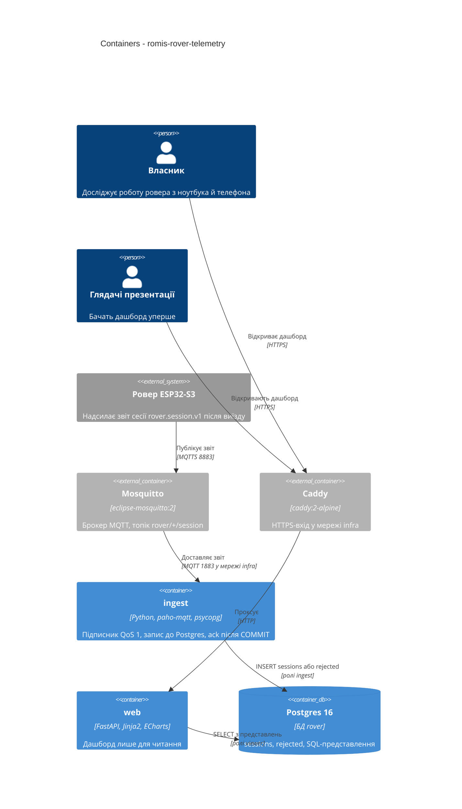

# Architecture map — romis-rover-telemetry

> **Цільовий фундамент** (greenfield): код ще не написано. Карту створено `/sdd:survey`
> з рішень `docs/inputs/initial-plan.md`, `docs/inputs/owner-decisions.md`, `docs/constitution.md`
> і підтвердженого власником пакета фундаменту (2026-10-23). Після `/sdd:scaffold` рядки
> «Wired at» отримають реальні `file:line`; до того посилання вказують на документи-джерела.

## Stack

- Мова / середовище: Python 3.12 (на VPS `python3 3.12.3`; образ `python:3.12-slim`) — ADR-0001.
- Ingest: `paho-mqtt` 2.x (`manual_ack`), `psycopg` 3 — `docs/inputs/initial-plan.md` §Прийняті рішення.
- Дашборд: FastAPI + Jinja2 + Apache ECharts (файл віддається зі `static/`, без CDN і без збірки фронтенду) — ADR-0001.
- Дані: Postgres 16 (наявний контейнер `postgres`, окрема БД `rover`) — ADR-0003.
- Міграції: `yoyo-migrations` (SQL-файли up/down) — ADR-0003.
- Збірка / тести / лінт (команди для `implement`):
  - build: `docker compose build`
  - test: `pytest` (інтеграційні тести маркуються `integration`, піднімають реальний Postgres)
  - lint: `ruff check . && ruff format --check . && mypy src`
- Залежності й запуск: `pyproject.toml` + `.venv` (`python3 -m venv`), без додаткових менеджерів пакетів.
- Деплой: один `Dockerfile`, два сервіси в `docker-compose.yml` у зовнішній мережі `infra`; назовні лише через Caddy — `docs/constitution.md` №12.

## C4 — цільова система

Межа відповідальності: ровер нічого не отримує з сервера (конституція №11); `web` не пише в БД, `ingest` не читає.

## Module inventory

Один Python-пакет `src/rover_telemetry/`; два процеси (`ingest`, `web`) збираються з одного коду й одного образу. Цільовий стан після `/sdd:scaffold`.

| Module | Path | Layers | Wired at | Responsibility |
|---|---|---|---|---|
| domain | `src/rover_telemetry/domain/` | чисті функції й типи, без I/O | (після scaffold) | Розбір і валідація звіту за контрактом, похідні метрики, константи ровера з посиланням на джерело |
| db | `src/rover_telemetry/db/` | доступ до Postgres | (після scaffold) | Підключення, вставка сесії / відхиленого, читання з представлень |
| ingest | `src/rover_telemetry/ingest/` | infra: MQTT-підписник | (після scaffold) | `manual_ack`, фіксований client id, `clean_session=false`, ack після COMMIT |
| web | `src/rover_telemetry/web/` | infra: HTTP | (після scaffold) | FastAPI-застосунок, Jinja2-шаблони, статичні файли, JSON-ендпоінти для графіків |
| config | `src/rover_telemetry/config.py` | налаштування | (після scaffold) | Читання змінних середовища (назви — у `.env.example`) |
| migrations | `migrations/` | SQL | (після scaffold) | Пронумеровані пари `NNNN_<назва>.sql` + `NNNN_<назва>.rollback.sql` |
| tests | `tests/{unit,integration,fixtures}/` | pytest | (після scaffold) | Реальні звіти seq 26 і 27 у `tests/fixtures/` (конституція №15) |

Правило залежностей: `domain` нічого не імпортує з проєкту; `db` залежить від `domain`; `ingest` і `web` залежать від `domain` і `db`, але не одне від одного.

## Conventions (правила, яких дотримується кожна фіча)

Рядки без файлу в репозиторії посилаються на документ-джерело; після scaffold додати приклад із коду.

- **Реєстрація модулів:** точки входу `python -m rover_telemetry.ingest` і `python -m rover_telemetry.web` (uvicorn); інших шарів реєстрації немає — `docs/constitution.md` №12 (сервіси в мережі `infra`).
- **Помилки:** невалідне повідомлення не падає процес — зберігається в таблицю відхилених з причиною, потім ack — `docs/constitution.md` №7. Виняток у `domain` — власний `ReportError`; HTTP-помилки дашборду — стандартні відповіді FastAPI.
- **Ідентифікатори:** природний ключ сесії `(mac, seq)`, окремого сурогатного ключа не вводимо — `docs/constitution.md` №6, `docs/inputs/initial-plan.md` §Дедублікація.
- **Доступ до БД:** `psycopg` 3 з сирим SQL (без ORM), параметризовані запити; ролі `owner` / `ingest` (INSERT) / `viewer` (SELECT) — `docs/constitution.md` №10, ADR-0003.
- **NULL:** відсутнє значення — `NULL` у БД, `None` у `domain`, «немає даних» в інтерфейсі; агрегації не підставляють 0 — `docs/constitution.md` №4.
- **Сирі дані:** повний `payload jsonb` зберігається поруч із розібраними колонками; невідомі поля ігноруються — `docs/constitution.md` №8.
- **Час:** `received_at timestamptz` ставить сервер; у UI підпис «отримано», пояс Europe/Kyiv — `docs/constitution.md` №5, `docs/inputs/owner-decisions.md` №11.
- **Міграції:** `yoyo-migrations`, файли `migrations/NNNN_<назва>.sql` і `NNNN_<назва>.rollback.sql`; застосовані міграції не змінюються — `docs/constitution.md` №16, ADR-0003.
- **Тести:** `pytest`; `tests/unit/` без I/O; `tests/integration/` (маркер `integration`) на реальному Postgres 16 в ефемерному контейнері; розбір звіту тестується фікстурами з `tests/fixtures/` — `docs/constitution.md` №15.
- **Лінт і типи:** `ruff` (check + format) і `mypy --strict` по `src/`; без нових попереджень — `docs/constitution.md` №14.
- **CI:** один workflow GitHub Actions: ruff, mypy, pytest (unit + integration).
- **Секрети:** лише змінні середовища з `~/.config/claude-secrets/rover.env` / `.env` (поза git), у репозиторії `.env.example` — `docs/constitution.md` №9.
- **UI / стиль:** шаблони Jinja2, один власний CSS без фреймворку, ECharts як єдина бібліотека графіків; мобільна розкладка обов'язкова — `docs/inputs/owner-decisions.md` №13 (деталі — у `/sdd:design-system`).

## Datastores

| Store | Engine | Accessed via | Notes |
|---|---|---|---|
| БД `rover` | Postgres 16 (контейнер `postgres`, образ `pgvector/pgvector:pg16`) | `psycopg` 3, ролі `ingest` / `viewer`; міграції від ролі `owner` | Таблиці `sessions` (розібрані колонки + `payload jsonb`) і `rejected`; представлення для агрегацій (по днях, пропуски `seq`, похідні метрики). Бекапи `pg_dump` — після презентації (рішення власника №6) |
| Черга брокера | Mosquitto 2, `persistence true`, `max_queued_messages 1000` | постійна сесія підписника `ingest` | Береже QoS 1 повідомлення, поки `ingest` не підключений — `/opt/mosquitto/config/mosquitto.conf` |

## Frontend / UI foundation

Репозиторій має фронтенд, але готових компонентів немає. Фундамент:

- **Бібліотека компонентів / дизайн-система:** немає; створюється в `docs/design-system.md` (`/sdd:design-system`, раз на репозиторій), до цього — лише Jinja2-шаблони з базовим макетом `web/templates/base.html` (після scaffold).
- **Токени дизайну:** CSS-змінні в одному файлі `web/static/app.css` (після scaffold); значення кольорів і відступів визначає `/sdd:design-system`.
- **Підхід до стилів:** один власний CSS, без Tailwind і без збірки — ADR-0001.
- **Спільні примітиви:** `base.html`, макрос картки показника, макрос порожнього стану «немає даних» (після scaffold).
- **Графіки:** Apache ECharts, файл `echarts.min.js` у `web/static/` (без CDN: презентація не має залежати від зовнішньої мережі).
- **Дані для графіків:** JSON-ендпоінти FastAPI поверх SQL-представлень; стан зберігає сервер, клієнтського стану немає.
- **Найближчий прецедент UI:** немає; перший екран («Підсумки + таблиця виїздів») стає прецедентом для решти.

## Where things live / closest precedents

- Нова вимога до розбору звіту → `src/rover_telemetry/domain/`, перевірка на фікстурах `tests/fixtures/`.
- Новий запис / читання даних → `src/rover_telemetry/db/` + нова міграція (SQL-представлення або колонка).
- Новий блок дашборду → ендпоінт у `src/rover_telemetry/web/` + шаблон + графік ECharts; прецедента ще немає.
- Нова зміна контракту ровера → не змінюється тут: запит до власника ровера (конституція №1, №2).

## Constraints & known tech-debt

- Контракт канонічний і не редагується — `docs/contracts/events.md`; константи ровера (діаметр колеса 44 мм, поріг перешкоди 190 мм, відсічка 6.0 В) беруться з контракту, не вигадуються — `docs/constitution.md` №3.
- Дедлайн презентації 2026-10-26: пріоритет — ingest і блок «Підсумки + таблиця виїздів» — `docs/idea-brief.md` §6.
- Втрата сесій до запуску `ingest` безповоротна; облік пропусків `seq` починається з першого отриманого — `docs/inputs/owner-decisions.md` №7.
- Домен дашборду й блок Caddy: UNKNOWN — власник має назвати піддомен `*.romis.cloud` до розгортання `web` (ставиться в `/sdd:roadmap` / `/sdd:specify`). Блок додається в `/opt/n8n/Caddyfile`.
- Імена облікових записів брокера (`rover-ingest`, `rover-viewer`) і ролей Postgres фіксуються в `docs/inputs/owner-decisions.md` №5 і ADR-0003; ACL звужується разом із запуском `ingest`.
- `yoyo-migrations` з драйвером `psycopg` 3 перевіряється в scaffold-задачі S3; якщо несумісний — новий ADR, а не мовчазна заміна інструмента.

## Reconciliation with the authored architecture doc

Авторського `docs/architecture.md` немає. Карта узгоджена з `CLAUDE.md` проєкту (§Інфраструктура сервера), `docs/constitution.md` і `docs/inputs/initial-plan.md`. Розбіжність знайдена одна: `initial-plan.md` каже «домен за Caddy з автентифікацією», а конституція №12 і рішення власника №4 — публічний без автентифікації; карта слідує конституції.
