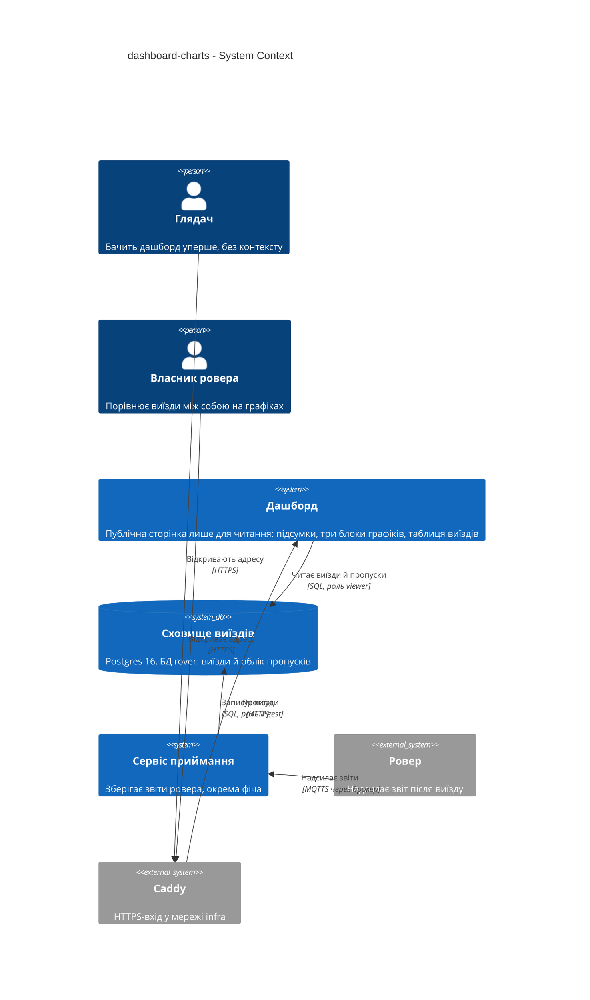
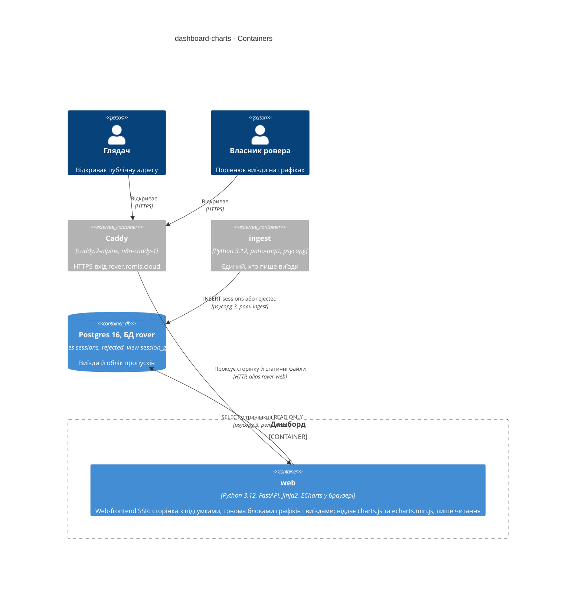
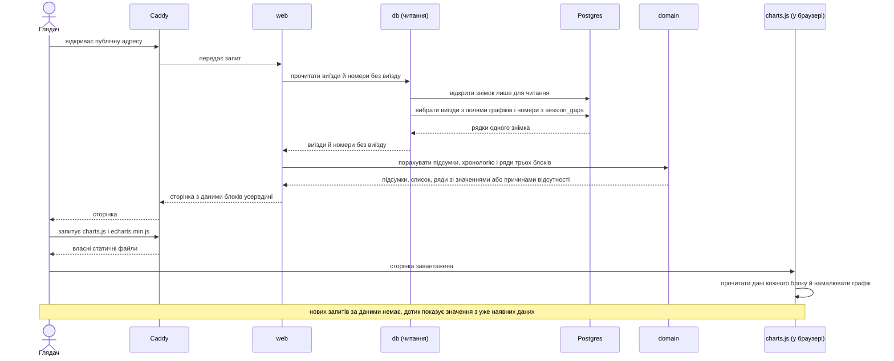
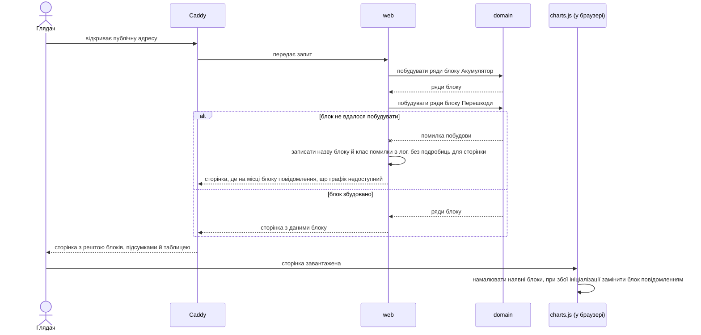

# Software Architecture Document — dashboard-charts

<!-- 12 Arc42 sections. Empty section → <!-- N/A: <one-line reason> -->. -->
<!-- C4 Context (L1) lives inline in §3. C4 Container (L2) lives inline in §5. -->
<!-- Numbers in §10 come VERBATIM from spec.md §6 NFR — no inventing, no rounding. -->

> Фундаментальні ADR проєкту (`docs/adr/0001…0003`) тут називаються «фундаментальний ADR-NNNN»; ADR фічі `dashboard-summary` — «summary ADR-NNNN». ADR цієї фічі лежать у `adr/` і нумеруються окремо (0001…0003).

## 1. Introduction and goals

**Intent.** Три блоки з графіками на тій самій публічній сторінці лише для читання, між підсумками й таблицею виїздів: «Акумулятор», «Перешкоди», «Рух і борти». Глядач без контексту за кілька секунд бачить, як розряджався акумулятор, перед чим ровер зупинявся і чи їхали борти однаково; Власник ровера порівнює виїзди між собою. Кожен виїзд стоїть за номером сесії, відсутнє значення ніде не стає нулем, втрачені номери лишаються видимими на осі (spec §1, §2).

**Top-3 quality goals (1-liners; full scenarios in §10):**

1. **Достовірність відсутнього** — «немає даних», «утримань не було» і причини відсутності швидкості не показані числом чи точкою на нулі; втрачені номери видно на осі, час названо «отримано».
2. **Безпечна й автономна публічна поверхня** — лише читання, жодних сторонніх вузлів, збій одного блоку не ламає решту сторінки, зупинка дашборду не зупиняє збереження звітів.
3. **Швидка, свіжа й придатна на телефоні сторінка** — дані формуються за ≤ 1 с (p95) при ≤ 1000 збережених виїздів, новий виїзд видно при першому оновленні, графіки читаються від 360 px без прокручування вбік.

**Stakeholders.**

| Role | Interest | Sign-off owner? |
|---|---|---|
| Глядач | Бачить дашборд уперше й без контексту: графіки мають бути зрозумілі з опису і не вводити в оману | No |
| Власник ровера | Порівнює виїзди (напруга, просадка, відстань до перешкоди, швидкості бортів); відсутнє не плутається з нулем | No |
| Оператор сервера | Публікує сторінку, стежить, щоб збій дашборду не зачіпав приймання звітів | No |
| Tech Lead (12romis) | Затвердження SAD | Yes |

<!-- Decision overrides (¶4) — populated by the critic resolution loop, empty otherwise. -->

- Decision override: дані графіків вбудовані в сторінку, а не віддаються окремими JSON-ендпоінтами — rationale: карта архітектури (`docs/architecture-map.md`, «Дані для графіків») писалась до коду й планувала ендпоінти; один знімок читання на сторінку гарантує збіг графіків, підсумків і таблиці (AC-22) і дає блокам ізоляцію без нових маршрутів, див. ADR-0001. Карту оновить наступний `survey`.
- Decision override: стан «завантаження» графіка відсутній, дані не йдуть з JSON-ендпоінтів — rationale: `docs/design-system.md` (рядок «Графік ECharts», стани default / loading / empty / error, дані з ендпоінтів) і `ux-flows.md` (loading як стан блоку) писались до ADR-0001; стани блоку тут — з даними, немає даних, недоступний (заповнювач до ініціалізації — лише текст). `screens` і наступний `design-system` приводять документи у відповідність.
- Decision override: CSP не розширюється для сторінок із графіками — rationale: summary ADR-0002 (Neutral) припускав «CSP доведеться розширити»; ADR-0002 цієї фічі зберігає `default-src 'self'` (скрипти й дані зі свого вузла, дані — нешкідливі блоки JSON).
- Decision override: лінії між виїздами не будуються — rationale: `ux-flows.md` US-08 (вузол «лінії неперервні») припускав неперервні лінії; напруга наприкінці виїзду не продовжується початком наступного, форму лишено дизайну (spec §8), тож `ux-flows.md` US-08 оновлює `screens`.

## 2. Constraints

**Technical.**
- Python 3.12 (образ `python:3.12-slim`), FastAPI + Jinja2 (шаблони на сервері), `psycopg` 3 з сирим SQL без ORM (`docs/architecture-map.md`, фундаментальні ADR-0001, ADR-0003).
- Postgres 16, БД `rover`; дашборд підключається роллю `viewer` (`GRANT SELECT` на `sessions`, `session_gaps` — міграції `0002`, `0004`). Усі потрібні графікам колонки вже є в `sessions` (`voltage_*_mv`, `holds_*`, `tof_control_off_ms`, `moving_ms`, `speed_*`, `encoders_*`, `end_reason`); **нової міграції, ролі чи права немає**.
- Шари `domain` ← `db` ← `web`; `domain` без I/O (фундаментальний ADR-0002); розрахунок з одного знімка читання в `domain` — summary ADR-0001.
- Бібліотека графіків — Apache ECharts, єдина (фундаментальний ADR-0001, `docs/architecture-map.md` §Frontend): файл `echarts.min.js` **ще не додано** у `web/static/`; без CDN і без збірки фронтенду.
- Заголовок `Content-Security-Policy: default-src 'self'` лишається без змін: ні inline-скриптів, ні стилів, ні сторонніх вузлів (`web/app.py`, spec §6.1 «політика захисту не послаблена», AC-21).
- Власний CSS у `web/static/app.css` з токенами в `:root`; кольори графіків беруться з нього (`docs/design-system.md`).
- Мобільна розкладка: від 360 px, одна колонка, без прокручування вбік; натискні елементи ≥ 44 px (`docs/design-system.md`, spec §6).
- Контракт `rover.session.v1` канонічний (`docs/contracts/events.md`): нових полів і обчислень поза контрактом немає (конституція №2, №3).

**Organisational.**
- Один розробник. Презентація 2026-10-26 (понеділок) — жорсткий дедлайн; якщо не встигнути всі три блоки, першим відкидається «Рух і борти» (`docs/roadmap.md` «Decisions so far», spec §1).
- Маршрут `quick` (рішення власника 2026-10-24); розмір L.

**Conventions.**
- `docs/constitution.md` (зокрема №3, №4, №5, №6, №10, №11, №12, №14, №15) і `docs/architecture-map.md` §Conventions; `ruff`, `mypy --strict`, тести на реальних фікстурах `tests/fixtures/` (seq 26 і 27) та реальних сесіях 36–39.
- Відсутнє значення — `NULL` у БД, `None` у `domain`, «немає даних» в інтерфейсі; число без джерела (контракт, `docs/inputs/owner-decisions.md`) у коді не з'являється.

**Regulatory / external.**
- Дані публічні, персональних даних немає (spec §6.1); автентифікації немає (конституція №12, рішення власника №4). Security review: Required (spec §6.1) — перед публікацією перевірити, що нові файли графіків віддаються з власного вузла, CSP не послаблена, текст зі звіту не потрапляє в розмітку.
- ECharts — Apache-2.0: файл ліцензії лежить поруч із закріпленою копією (`static/VENDOR.md`, §8), що важливо для майбутнього публічного репозиторію.

## 3. Context and scope

Дашборд — та сама сторінка, яку Глядач і Власник ровера відкривають у браузері на телефоні чи ноутбуці; фіча додає на неї три блоки з графіками. Дані беруться з того, що вже зберіг сервіс приймання, назад не відправляється нічого (конституція №11). Межа довіри проходить по публічній адресі: усе, що надходить з браузера, ігнорується (дій запису немає), усе, що йде зі звіту ровера, вважається недовіреним текстом.

<!-- brownfield: код змерджено й працює: `web/app.py` (`GET /`, `/healthz`, заголовки безпеки з `no-store` на всі відповіді, включно зі `/static`), `db/reading.py` (знімок `REPEATABLE READ` + `READ ONLY`, читає `sessions` і `session_gaps`), `domain/dashboard.py` (`StoredSession`, `Total(sum, missing, total)`, `EndReason`), `domain/timeline.py`, шаблони з макросами (`metric_card`, `no_data`, `state_message`), `app.css` з токенами; `static/echarts.min.js` немає; `StoredSession` не містить колонок `holds_min_*`, `holds_*` по датчиках, `tof_control_off_ms`, `speed_*`, `encoders_*` (вони є в таблиці). `docs/architecture-map.md` відображає стан до scaffold (reflects_commit e52fadb) — для цієї фічі спираємось на код, а не на карту. -->

**External systems (in / out):**

| Actor or system | Type | Interaction |
|---|---|---|
| Глядач | Person | Відкриває публічну адресу, читає опис і графіки, дотикається до виїзду |
| Власник ровера | Person | Те саме, плюс порівнює виїзди між собою |
| Оператор сервера | Person | Публікує оновлений образ `web`; поза сценаріями сторінки |
| Caddy (`n8n-caddy-1`) | System (external) | Приймає HTTPS на `rover.romis.cloud`, проксує до `web` |
| Сервіс приймання `ingest` | System (internal, фіча ingest) | Єдиний, хто пише виїзди; з дашбордом напряму не взаємодіє, зв'язок лише через сховище |
| Сховище виїздів (Postgres 16, БД `rover`) | System (internal) | Віддає дашборду виїзди й облік пропусків; лише читання |
| Ровер | System (external) | Надсилає звіти до `ingest`; від дашборду нічого не отримує |
| Сторонні вузли (CDN, шрифти, аналітика) | — | **Немає свідомо**: сторінка, включно з бібліотекою графіків, працює без зовнішньої мережі (AC-21) |

**C4 Context (L1):**



## 4. Solution strategy

**Target surface: `web-frontend`.** Фіча додає блоки на єдину сторінку в браузері для Глядача й Власника ровера (spec §1 «для кого», §4 ролі, `ux-flows.md` SCR-01…SCR-05). Окремого програмного інтерфейсу немає: сторінку, дані блоків і статичні файли віддає той самий процес `web`, тож `backend-service` другою поверхнею не оголошується.

**UI-архітектура: SSR з острівцями ECharts** (server-side rendering: HTML формує сервер; «острівець» — місце на сторінці, яке оживляє невеликий скрипт). Текст, опис блоків, схема датчиків (вбудований SVG) і дані графіків формуються на сервері; `static/charts.js` лише читає готові дані й малює графіки. Клієнтського стану й роутингу немає (одна сторінка, `ux-flows.md` §Platform decisions); єдина взаємодія — дотик або наведення, що показують значення виїзду. На відміну від summary ADR-0002 (сторінка без скриптів), тут скрипт обов'язковий, але лише зі свого вузла — рішення в ADR-0001 і ADR-0002. Дизайн-канон і компоненти — `docs/design-system.md`: повторно використовуємо `base.html`, `metric_card`, `no_data`, `state_message`; новий компонент один — «блок графіка» (SCR-02…SCR-04), деталі — стадія `screens`.

**Top strategic choices (the seeds for ADRs):**

1. **Дані графіків — з того самого знімка, що й підсумки, і вбудовані в сторінку** — `GET /` будує ряди трьох блоків у `domain` з рядків одного знімка читання і кладе їх у HTML як нешкідливі блоки даних; нових маршрутів немає. Це дає збіг графіків, підсумків і таблиці (AC-22) та відсутність стану «завантаження» — ADR-0001.
2. **ECharts з власного вузла, політика безпеки без змін** — закріплена копія бібліотеки у `static/`, власний `charts.js` без збірки, малювання на `<canvas>`; схема датчиків — вбудований SVG, що працює й без скрипта. Презентація не залежить від зовнішньої мережі (AC-21) — ADR-0002.
3. **Причину відсутності значення вирішує `domain` і передає разом із точкою** — графік отримує або число, або «пропуск» плюс код причини й готовий підпис; правила `null` ≠ 0 та причин («не їхав», «без енкодера», «прямої ділянки не було», «утримань не було») живуть в одному місці й перевіряються `pytest` без браузера — ADR-0003.
4. **Блоки незалежні й лише читають** — кожен блок будується окремо під захистом `try/except` на межі `web`, а `charts.js` ініціалізує кожен графік окремо; збій одного дає на його місці повідомлення (AC-19). Читання лишається під роллю `viewer` і транзакцією `READ ONLY` (summary ADR-0001, конституція №10, №11).

Тактичні рішення без ADR (відкат — години, не дні): 
- **Вісь** — категорії за номером сесії від найменшого до найбільшого збереженого; кожен номер із `session_gaps` — порожня категорія «сесія не дійшла»; лінії між виїздами не будуються (напруга наприкінці одного виїзду не продовжується початком наступного, між ними акумулятор міг заряджатися), кожен виїзд — окремі позначки, відрізняються формою й підписом, не лише кольором (spec §6 «Читабельність кольорів»); остаточна форма — `screens`.
- **Схема датчиків** — вбудований SVG у шаблоні Jinja2 (макрос), числа — текст усередині; сума лічильників датчиків ніде не подається як кількість утримань, справжня кількість утримань — з `holds_count` (підсумок `Total` з summary ADR-0001).
- **Константи** (відсічка 6.0 В, повний заряд 8.4 В, поріг 190 мм, 2 банки, коефіцієнт 0.1382 м) — іменовані в `domain/charts.py` з посиланням на джерело (контракт, рішення власника №8, №9, конституція №3) і передаються в JS у даних; у `charts.js` чисел немає.
- **Кеш** — HTML лишається `no-store` (spec §6 «кешування даних — 0 с»), а `/static` отримує `Cache-Control: no-cache` (повторне завантаження лише після перевірки ETag): без цього кожне оновлення сторінки тягло б бібліотеку заново (розмір — `VENDOR.md`).
- **Збій блоку** — на сервері блок, що не збудувався, замінюється повідомленням; у браузері графік, що не ініціалізувався (або вимкнений скрипт), — тим самим повідомленням (`noscript`/заповнювач). Збій самого сховища, як і раніше, дає 503-сторінку з описом (summary SAD).

**Assumptions ledger (easy depth)** — рішення, ухвалені без питання; власник може ветувати:

- Поверхня одна — `web-frontend`; нових маршрутів, міграцій, ролей, прав і змін `ingest` немає.
- Нові дані блоків читаються з тих самих `sessions` одним знімком; `StoredSession` розширюється необов'язковими полями (`None` за замовчуванням), `read_snapshot` читає ще й нові колонки, а `payload` лишається як є для таблиці.
- Новий модуль `domain/charts.py` (чисті функції) і шаблони-частини `_charts_*.html`; решта шарів — наявні.
- Пріоритет причин відсутності швидкості: не їхав → без енкодера (із зазначенням борту) → прямої ділянки не було (лише для різниці бортів) → не передано; позначка «без енкодера» (AC-13) від цього порядку не залежить. Перевіряється на фікстурах і сесіях 36–39 у `plan-tests`.
- Браузерні перевірки (CSP, дотик, ширина 360 px) — `tests/e2e/` на Playwright: нова dev-залежність і позначка `e2e` (поза `pytest -m 'not integration'`), додає `implement` у `pyproject.toml`.
- Закріплена версія ECharts 5.x, точну версію й SHA-256 фіксує `implement` у `static/VENDOR.md`; повна збірка без урізання компонентів (урізання — оптимізація після презентації).
- Підпис кожного значення — «отримано» за київським часом лише в підказці виїзду (SCR-05); вісь називається «Номер сесії».

## 5. Building block view

Прості шари за фундаментальним ADR-0002, як у summary SAD: чистий `domain` (ряди графіків, причини відсутності, константи), `db` (читання сирим SQL), `web` (маршрут, шаблони, підписи, статичні файли). Новий модуль не створюється: додається файл `domain/charts.py`, змінюються наявні `domain/dashboard.py`, `db/reading.py`, `web/*`. Правило залежностей не змінюється: `domain` не імпортує нічого з проєкту, підписи (рядки інтерфейсу) додає `web`.

**Internal decomposition** (імена файлів — пропозиція для `tasks`):

```
src/rover_telemetry/
├── domain/
│   ├── dashboard.py        # наявний; StoredSession + необов'язкові поля графіків; Total(sum, missing, total)
│   ├── timeline.py         # наявний, не змінюється
│   └── charts.py           # НОВИЙ, без I/O: вісь за seq з порожніми місцями, ряди трьох блоків,
│                           #   Value | Absent(reason), AbsentReason, константи з джерелами
├── db/
│   └── reading.py          # наявний; _SESSION_COLUMNS + нові колонки sessions; той самий знімок
├── web/
│   ├── app.py              # _render: дані блоків під try/except, Cache-Control для /static
│   ├── formatting.py       # підписи причин і датчиків, борт, м/с, В на банку (рядки інтерфейсу)
│   ├── templating.py       # реєстрація нових функцій; дані блоків лише через |tojson
│   ├── templates/          # dashboard.html + _charts_battery.html, _charts_obstacles.html (SVG-схема),
│   │                       #   _charts_motion.html; макроси блоку, повідомлення «графік недоступний»
│   └── static/
│       ├── app.css         # наявний; стилі блоків і токени кольорів графіків
│       ├── charts.js       # НОВИЙ: читає блоки даних, ініціалізує ECharts на блок, повідомлення при збої
│       ├── echarts.min.js  # НОВИЙ: закріплена копія
│       └── VENDOR.md       # НОВИЙ: версія, джерело, SHA-256, ліцензія Apache-2.0
tests/
├── unit/                   # test_charts_*.py: причини, нуль проти «немає даних», вісь, константи
├── e2e/                    # Playwright (позначка e2e): CSP, дотик, ширина 360 px, 0 запитів назовні
└── integration/            # сторінка на реальному Postgres: блоки, фікстури seq 26/27, сесії 36–39
```

**C4 Container (L2):**



## 6. Runtime view

Два керівних сценарії; решту AC (порожнє сховище, нуль проти «немає даних», пропуски, відхилені, дубль, дотик на телефоні) покриває стадія `sequences`. Збій самого сховища описано в summary SAD §6 (flow 2) і діє без змін: сторінка 503 без блоків.

**Critical flow 1: показ сторінки з графіками (AC-01, AC-05, AC-10, AC-15, AC-22)**



**Critical flow 2: один блок не вдалося побудувати (AC-19)**



## 7. Deployment view

Нових сервісів немає: фіча їде в наявному сервісі `web` (той самий образ `rover-telemetry`, мережа `infra`, alias `rover-web`, один блок `reverse_proxy` у Caddy — summary SAD §7). У образ додаються три статичні файли (`charts.js`, `echarts.min.js`, `VENDOR.md`); `pyproject.toml` уже включає `web/static/*` у пакет, `Dockerfile` не змінюється. Порти на хост не публікуються (конституція №12), змінних середовища й секретів нових немає. Одна репліка.

Закріплену копію ECharts `implement` один раз завантажує через npm на машині розробки й коммітить у репозиторій із SHA-256 у `VENDOR.md`; у проді мережа для цього не потрібна. Зупинка `web` не зупиняє збереження звітів (AC-21, spec §6 «Ізоляція від приймання»): `ingest` від `web` не залежить.

**Monitoring:**
- Метрики: окремого сервера метрик немає; логи `web` через `docker logs`.
- Нові рядки логу: `chart_block_failed block=battery error_class=ValueError` (значення `block`: `battery`, `obstacles` або `motion`) — без вмісту звітів і без паролів; помилки ініціалізації в браузері в лог сервера не потрапляють (скрипт показує повідомлення на місці блоку).
- Алерти: немає (рішення власника №12 — сповіщення не в першій версії).
- Перевірка життя: наявний `/healthz`; доступ ззовні — відкриття публічної адреси.

**Scaling thresholds:**
- Спека розрахована на ≤ 1000 збережених виїздів (spec §6); дані трьох блоків вбудовані в сторінку, тож їхня вага росте лінійно разом із вагою вбудованих звітів таблиці (summary SAD §7); точний розмір — замір у `plan-tests`, оцінки в цьому документі немає.
- Над ≤ 1000 виїздів потрібне рішення про довжину графіків (spec §8, питання «після презентації 2026-10-26»): останні N виїздів або прокрутка осі; сам ECharts працює з категоріальною віссю такої довжини, а ціна вбудовування даних зростає разом із ними.

## 8. Crosscutting concepts

| Concept | Convention | Where defined |
|---|---|---|
| Logging | Рядки `key=value` у stdout; збій блоку — `chart_block_failed block=… error_class=…`, на сторінку — лише загальне повідомлення; вмісту звітів і паролів у логах немає | summary SAD §8, тут |
| Authentication / AuthZ | Автентифікації немає (конституція №12). Право читання забезпечують роль `viewer`, транзакція `READ ONLY` і відсутність маршрутів зі змінами; дозволений лише `GET`; нових маршрутів немає | конституція №10, №11, summary ADR-0001 |
| Error handling | Збій сховища — 503 із повідомленням без подробиць (наявне). Збій побудови блоку — `try/except` на межі `web` для кожного блоку окремо, повідомлення «графік недоступний» на його місці. Збій у браузері — окремо для кожного блоку в `charts.js`; без скрипта — те саме повідомлення | тут, ADR-0001 |
| NULL vs 0 | `NULL` → `None` → `Absent(reason)` у `domain/charts.py` → `null` у даних блоку з кодом причини і підписом → пропуск на графіку й «немає даних» у підказці; виміряний нуль лишається числом. «Утримань не було» — окремий вид відсутності (виміряно, що їх не було), не «немає даних». `charts.js` жодної причини не вигадує і не підставляє 0 | конституція №4, ADR-0003 |
| Time | Лише `received_at` як підпис значення в підказці виїзду, «отримано», Europe/Kyiv; вісь — номер сесії; слів «час виїзду», «час сесії» немає | конституція №5, summary SAD §8 |
| Lost sessions | Номери з `session_gaps` — порожні категорії осі з підписом «сесія не дійшла»; лінія не з'єднує сусідні виїзди; відхилений номер на осі не відрізняється від втраченого | конституція №6, ingest ADR-0004, spec AC-15, AC-23 |
| Output escaping | Дані блоків — лише через `|tojson` (екранує `<`, `>`, `&`, `'`), у блок `<script type="application/json">`, який браузер не виконує; текст зі звіту (назва датчика, причина завершення, прошивка) до підказок доходить або як значення зі словника відомих підписів на сервері, або як невідоме значення, яке `charts.js` вставляє лише як текст (`textContent`, а не `innerHTML`); у ECharts формат підказки не складає HTML зі звітних рядків. Фільтра `safe` немає | spec §6.1, ADR-0002 |
| Security headers | `Content-Security-Policy: default-src 'self'`, `X-Content-Type-Options`, `Referrer-Policy` — без змін; `Cache-Control: no-store` для HTML, `no-cache` для `/static` | `web/app.py`, тут |
| Caching | Дані — 0 с (HTML `no-store`, spec §6); статичні файли — перевірка ETag на кожне відкриття, без `max-age` | spec §6, тут |
| Constants & sources | Відсічка 6.0 В, повний заряд 8.4 В, поріг 190 мм, 2 банки, коефіцієнт 0.1382 м, 60 с — іменовані константи в `domain/charts.py` із посиланням на джерело; передаються в JS у даних | конституція №3 |
| Colours & accessibility | Кольори графіків — CSS-змінні в `app.css` (єдине джерело токенів), `charts.js` читає їх через `getComputedStyle`; кожна серія відрізняється формою й підписом, контраст ≥ 4.5:1 перевіряється тестом токенів | `docs/design-system.md`, spec §6 |
| Vendored assets | Сторонній файл у репо — лише закріплена версія з SHA-256 і ліцензією у `static/VENDOR.md`; оновлення — окрема зміна, що перераховує SHA-256 | тут, ADR-0002 |
| Configuration / secrets | Нових змінних середовища немає | `.env.example` без змін |
| Internationalisation | N/A — єдина мова інтерфейсу українська, підписи простою мовою без внутрішніх термінів | — |

## 9. Architecture decisions

| # | Title | Status | Section |
|---|---|---|---|
| 0001 | Embed chart data in the page from one read-only snapshot | Accepted | §4 |
| 0002 | Draw charts with vendored ECharts under unchanged CSP | Accepted | §4 |
| 0003 | Decide absent-value reasons in domain and ship them with each point | Accepted | §4 |

ADR files live under `docs/features/dashboard-charts/adr/NNNN-<title>.md`.

## 10. Quality requirements

Числа нижче — дослівно зі spec §6; сама spec позначає їх припущеннями, які власник підтверджує до `/sdd:plan-tests` (spec §8).

**QG-1. Достовірність відсутніх значень**
- **When:** у сховищі є виїзд без частини напруг, виїзд без руху, виїзд без енкодера, виїзд без утримань, виїзд із вимкненим захистом від перешкод, виїзд із виміряним нулем і пропуски в нумерації сесій; Глядач відкриває сторінку.
- **Then:** 0 випадків, коли «немає даних» чи «утримань не було» показано числом або точкою на нулі; кожна відсутня швидкість має свою причину, причини не змішані; втрачені номери лишаються порожніми місцями осі.
- **How verify:** юніт-тести `domain/charts.py` на фікстурах seq 26 і 27 та реальних сесіях 36–39 (без Docker); інтеграційний тест сторінки на реальному Postgres; перегляд власником.

**QG-2. Безпечна й автономна публічна поверхня**
- **When:** Глядач відкриває сторінку без облікового запису; `web` зупинено на час надсилання звіту; один із блоків не вдалося побудувати.
- **Then:** 0 запитів до сторонніх вузлів; 0 втрачених звітів за зупиненого дашборду; 0 збоїв решти сторінки за збою одного блоку (3 з 3 незалежні); CSP `default-src 'self'` без змін; дій запису немає.
- **How verify:** перегляд мережевих запитів сторінки в браузерному тесті; перевірка запуску: зупинити дашборд, надіслати звіт, звіт збережено; тест AC-19, що ламає блоки по одному; тест заголовків і XSS-фікстура (рядок зі звіту з розміткою) — security review.

**QG-3. Швидка, свіжа й придатна на телефоні сторінка**
- **When:** відкривається сторінка при ≤ 1000 збережених виїздів; щойно збережено новий виїзд; екран телефона завширшки від 360 px.
- **Then:** затримка формування даних для графіків (p95) ≤ 1 с при ≤ 1000 збережених виїздів; новий збережений виїзд видно на графіках при першому оновленні сторінки (кешування даних — 0 с); немає горизонтального прокручування при ширині екрана від 360 px; натискні елементи ≥ 44 px; контраст кольорів графіків із тлом ≥ 4.5:1, а кожна серія відрізняється ще й підписом чи формою, не лише кольором.
- **How verify:** інтеграційний тест на згенерованих даних (затримка); тест AC-22 на реальному сховищі (актуальність); візуальна перевірка власником на телефоні й емулятор у тесті (ширина, натискні елементи); перевірка контрасту в тесті токенів.

## 11. Risks and technical debt

| Risk / debt | Severity | Mitigation | Owner |
|---|---|---|---|
| Дедлайн 2026-10-26: три блоки з графіками, закріплена бібліотека й браузерна перевірка за два дні | High | Блоки незалежні (ADR-0001), порядок робіт «Акумулятор» → «Перешкоди» → «Рух і борти»; «Рух і борти» відкидається першим за рішенням власника (spec §1); без нього сторінка лишається цілою | 12romis |
| ECharts на `<canvas>` та його підказки не перевірені під CSP `default-src 'self'` у реальному браузері | Medium | Перевірити в браузерному тесті першою задачею `implement`; якщо потрібне послаблення політики — не послаблювати: перейти на `renderer: 'svg'` або повернутися до рішення в ADR-0002 (нова ADR, що замінює) | 12romis |
| Текст зі звіту (назва датчика, причина завершення, прошивка) у підказках графіка — вставка розмітки (spec §6.1) | Medium | `\|tojson` для даних, словник підписів на сервері, невідоме значення лише як `textContent`; тест із фікстурою, де поля містять `</script>` і `` | 12romis |
| Бібліотека ECharts — порядку мегабайта (розмір повної збірки зафіксує `implement` у `VENDOR.md`, оцінка не заміряна) на телефоні: зараз `no-store` стоїть і на `/static`, кожне оновлення тягнуло б файл заново | Medium | `Cache-Control: no-cache` для `/static` (ETag), заміряти завантаження в `plan-tests`; урізання збірки ECharts — після презентації | 12romis |
| Вбудовані дані трьох блоків роблять сторінку важчою разом із вбудованими звітами таблиці; при ≤ 1000 виїздів вага невідома до заміру | Medium | Замір на згенерованих даних у `plan-tests`; обмеження довжини графіків — відкрите питання spec §8 (після 2026-10-26), тоді змінити ADR-0001 | 12romis |
| Пріоритет причин відсутності швидкості (не їхав → без енкодера → прямої ділянки не було) — рішення design, у контракті порядку немає; на реальних сесіях може дати неочікувану причину | Low | Перевірити на фікстурах і сесіях 36–39 у `plan-tests`; зміна — одна функція `domain` (ADR-0003) | 12romis |
| Відстань 6 мм у сесії 36 може бути артефактом датчика | Low | Показуємо як у звіті, нічого не фільтруємо (конституція №2, №3); питання власнику ровера до 2026-10-26 (spec §8) | 12romis (власник ровера) |
| Ровер один (рішення власника №10): вісь за `seq` для двох роверів перемішає виїзди | Low | Коли з'явиться другий ровер, потрібна нова spec (групування за `mac`) | 12romis |
| `docs/architecture-map.md` описує стан до scaffold і обіцяє JSON-ендпоінти для графіків | Low | Оновити наступним `survey`; фіча спирається на код і ADR-0001 | 12romis |
| Додавання колонок до `StoredSession` і `_SESSION_COLUMNS` зсуває позиційне створення `StoredSession(*row)` | Low | Нові поля в кінці зі значенням за замовчуванням; інтеграційний тест `test_reading.py` на всіх колонках | 12romis |

**Accepted debt (acceptable in v1, plan to fix later):**
- Усі виїзди на графіках без обмеження довжини, фільтрів і масштабування (spec §3, §8).
- Бібліотека ECharts повна, без урізання непотрібних компонентів.
- З'єднання з БД на запит без пулу (summary SAD) — не змінюється.
- Браузерний тест кількох сценаріїв (CSP, дотик), а не повне покриття `charts.js`: основні правила живуть у `domain` і перевіряються `pytest`.

## 12. Glossary

Терміни домену — з кореневого `CONTEXT.md` (канонічний; окремого файлу для цієї фічі немає); нижче лише технічні терміни, додані цією фічею.

| Term | Meaning |
|---|---|
| Глядач, Власник ровера, Оператор сервера | Ролі з `CONTEXT.md`: той, хто бачить дашборд уперше; той, хто досліджує ровер; той, хто підтримує сервер |
| Борт, Датчик, Утримання, Просадка, Різниця бортів, Захист від перешкод вимкнено, Немає даних, Отримано | Терміни з `CONTEXT.md`; на графіках вживаються з його визначеннями, зокрема датчик ≠ утримання |
| Блок графіка | Частина сторінки з описом, графіком або схемою одного з трьох видів: «Акумулятор», «Перешкоди», «Рух і борти» |
| Блок даних | `<script type="application/json">` у сторінці: дані одного блоку для `charts.js`; браузер його не виконує |
| Острівець | Місце на серверній сторінці, яке оживляє окремий скрипт (тут — графік ECharts); решта сторінки працює без скрипта |
| Вісь за номером сесії | Категорії від найменшого до найбільшого збереженого номера; номер без виїзду — порожнє місце «сесія не дійшла» |
| Причина відсутності | Код і підпис, чому значення немає: не їхав, на борту не було енкодера, прямої ділянки не було, утримань не було, не передано |
| Закріплена копія (vendored) | Файл бібліотеки, взятий один раз і лежачий у репозиторії з версією й SHA-256, а не завантажуваний із мережі |
