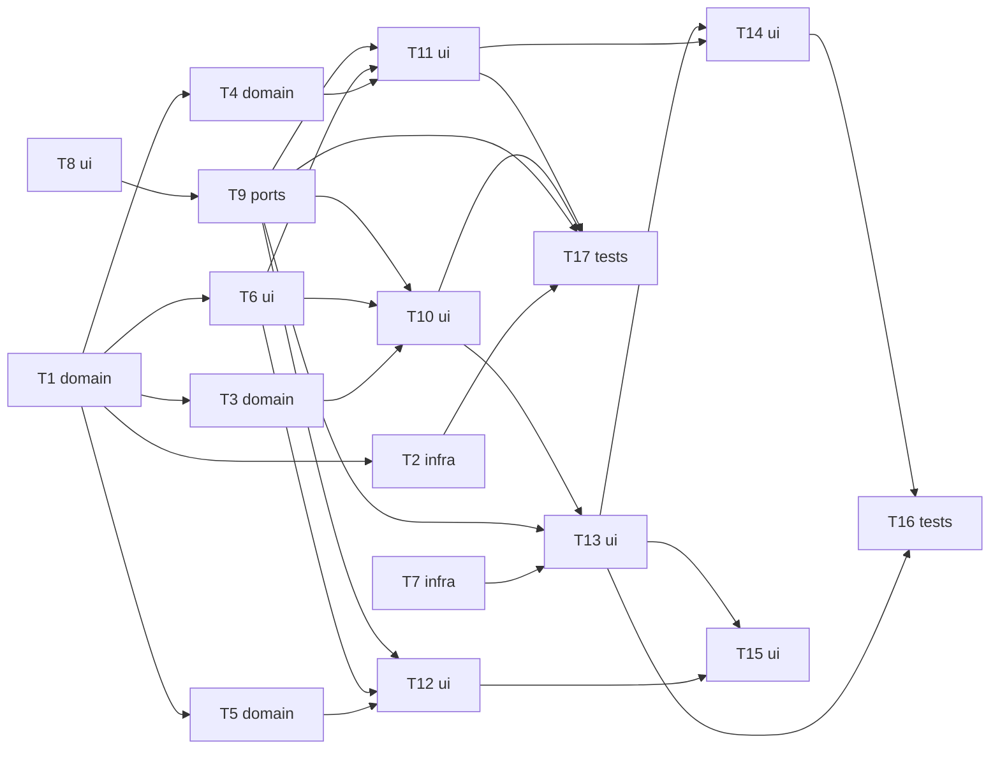

# Epic — dashboard-charts

> **Spec:** [spec.md](../spec.md) · **Design:** [sad.md](../sad.md) · **Screens:** [screens.md](../screens.md) · **Data model:** немає (нових колонок, міграцій, ролей і прав не потрібно, SAD §2) · **API:** немає (нових маршрутів немає; графіки вбудовані в `GET /`, ADR-0001) · **ADRs:** [adr/](../adr/)

## Goal

Три блоки з графіками — «Акумулятор», «Перешкоди», «Рух і борти» — на тій самій публічній сторінці лише для читання, між підсумками й таблицею виїздів. Виїзди стоять за номером сесії, відсутнє значення ніде не стає нулем, втрачені номери видно на осі, графіки читаються на телефоні й не залежать від зовнішньої мережі (spec §2 Goals). Дедлайн — презентація 2026-10-26.

## Scope

- **In:** `domain` (ряди трьох блоків, причини відсутності, вісь), `db` (нові колонки того самого знімка), `web` (реєстр блоків, шаблони, підписи, `charts.js`, токени), закріплена копія ECharts, браузерні й інтеграційні тести.
- **Out:** активність у часі, цикли заряду, склад часу, відхилені повідомлення, тренди й висновки, відсоток заряду, вісь за часом, фільтри, експорт (spec §3); нова міграція; зміни `ingest`; послаблення CSP; JSON-ендпоінти для графіків (ADR-0001).

## Task map

Паралельні гілки старту (хвиля 1): T1 (domain), T7 (ECharts + CSP-проба), T8 (токени й оболонка блока). Порядок блоків за дедлайном: Акумулятор (T3 → T10 → T13) → Перешкоди (T4 → T11 → T14) → Рух і борти (T5 → T12 → T15); «Рух і борти» відкидається першим.

## Tasks

See [tracker.md](./tracker.md) for status. Machine contract: [tasks.json](../tasks.json).

| # | Task | Layer | Blocked by | DoD (short) |
|---|---|---|---|---|
| T1 | Розширити StoredSession полями графіків і додати domain/charts.py: константи з джерелами, Value/Absent/AbsentReason, вісь за номером сесії з порожніми місцями | domain | — | юніт-тести осі й типів проходять без Docker (`pytest -m 'not integration'`) |
| T2 | Читати в read_snapshot нові колонки sessions для графіків тим самим знімком | infra | T1 | інтеграційний тест `test_reading.py` на всіх колонках проходить (потрібен Docker) |
| T3 | Побудувати в domain ряди блоку «Акумулятор»: три напруги, напруга на банку, просадка, причина завершення, відсутні значення | domain | T1 | юніт-тести блоку «Акумулятор» проходять без Docker: AC-01…AC-04 виражені в `domain` |
| T4 | Побудувати в domain ряди блоку «Перешкоди»: найменша відстань і датчик, «утримань не було», лічильники датчиків, секунди вимкненого захисту | domain | T1 | юніт-тести блоку «Перешкоди» проходять без Docker: AC-05…AC-09 виражені в `domain` |
| T5 | Побудувати в domain ряди блоку «Рух і борти»: швидкості в об/хв і м/с, різниця бортів, причини відсутності, «без енкодера» | domain | T1 | юніт-тести блоку «Рух і борти» проходять без Docker: AC-10…AC-13 виражені в `domain` |
| T6 | Додати в web/formatting.py підписи причин відсутності, датчиків і бортів, м/с, об/хв і напругу на банку | ui | T1 | юніт-тести `test_formatting.py` проходять без Docker |
| T7 | Закріпити ECharts у web/static з VENDOR.md, віддавати /static з no-cache і перевірити в браузері, що canvas працює під незміненим CSP | infra | — | `pytest -m 'not integration'` зелений без браузера (e2e пропущено) |
| T8 | Додати токени --chart-* з тестом контрасту та макроси «Блок графіка», «Список приміток», «Схему-заповнювач» зі станами блока | ui | — | тест токенів: кожен `--chart-*` ≥ 4.5:1 з тлом |
| T9 | Додати web/chart_blocks.py: реєстр блоків з ізоляцією збою кожного блоку, лог chart_block_failed і вивід блоків між підсумками та виїздами | ports | T8 | тести ізоляції блоків проходять без Docker: 3 з 3 незалежні (підставні збої по одному) |
| T10 | Побудувати блок «Акумулятор»: шаблон _charts_battery.html, опис, примітки і дані блока (напруга, на банку, просадка, причина завершення) | ui | T3, T6, T9 | тести шаблону блока проходять без Docker; дані блока серіалізуються через `|tojson` |
| T11 | Побудувати блок «Перешкоди»: шаблон _charts_obstacles.html зі схемою датчиків (SVG), карткою «Утримань усього», описом, примітками і даними блока | ui | T4, T6, T9 | тести шаблону блока проходять без Docker: схема працює без скрипта (чистий SVG/HTML) |
| T12 | Побудувати блок «Рух і борти»: шаблон _charts_motion.html, опис, примітки «немає даних»/«без енкодера» і дані блока | ui | T5, T6, T9 | тести шаблону блока проходять без Docker |
| T13 | Додати static/charts.js: ініціалізація ECharts по блоках з ізоляцією збою, вісь із порожніми слотами, підказка через textContent і графіки блока «Акумулятор» | ui | T7, T9, T10 | статичний тест `charts.js` проходить без браузера (немає заборонених викликів і доменних чисел) |
| T14 | Додати в charts.js графіки блока «Перешкоди»: найменша відстань на тлі порога 190 мм і секунди вимкненого захисту | ui | T11, T13 | e2e блока «Перешкоди» проходить у Chromium на 360 px: 0 порушень CSP, 0 сторонніх запитів |
| T15 | Додати в charts.js графіки блока «Рух і борти»: швидкість бортів у м/с із піками та різниця бортів із причинами відсутності | ui | T12, T13 | e2e блока «Рух і борти» проходить у Chromium на 360 px: 0 порушень CSP |
| T16 | Додати наскрізні браузерні тести сторінки: 360 px, дотик, 0 сторонніх запитів, CSP, збій кожного блока, XSS-фікстура | tests | T13, T14 | e2e-набір проходить у Chromium на 360 px |
| T17 | Додати інтеграційні тести сторінки на реальному Postgres: свіжість, дубль і відхилене, порожнє сховище, лише читання, затримка на 1000 виїздів | tests | T2, T9, T10, T11 | інтеграційні тести проходять з Docker (`pytest`) |

## Risks / Hard rules

- **Дедлайн 2026-10-26** (sad §11): порядок «Акумулятор» → «Перешкоди» → «Рух і борти»; відкидання «Руху і бортів» не торкається інших задач, бо його запис у реєстрі (T12) додається окремо.
- **`null` ≠ 0** (конституція №4, ADR-0003): правила причин живуть лише в `domain/charts.py`; `charts.js` нічого не вигадує й не містить доменних чисел.
- **CSP не слабшає** (ADR-0002): `default-src 'self'`, без inline-скриптів і стилів; перша перевірка — T7; запасний шлях — `renderer: 'svg'`.
- **Текст зі звіту — лише текст** (sad §8): `|tojson`, словник підписів на сервері, `textContent`; фільтра `safe` немає; тест із шкідливою фікстурою (T13, T16).
- **Лише читання** (конституція №10, №11): нових маршрутів, форм і прав немає; перевіряє T17.
- **Ізоляція блоків** (AC-19): кожен блок будується окремо під `try/except` (T9) і ініціалізується окремо в браузері (T13).
- **Смуги за перекриттям файлів:** T1/T3/T4/T5 діляють `domain/charts.py`; T9–T12 — `chart_blocks.py`; T13–T15 — `charts.js`: `implement` виконує їх послідовно в межах смуги.
