# UX flows — dashboard-charts

> Користувацькі флоу для кожної UI-історії §4, створені `ux-flows` (після `clarify`, перед `design`).
> Читають: `design` (докази для вибору поверхні й UI-архітектури), `sequences` (UI-флоу вирівнюються
> за id SCR), `screens` (деталізує кожен рядок інвентаря) і `plan-tests` (e2e-шляхи через UI).
> **Завжди markdown + mermaid `flowchart`**, незалежно від інструмента дизайну: це рівень потоку, не візуальний дизайн.

## Platform decisions

- **Posture:** mobile-first — за `docs/design-system.md` §Platform posture (глядачі презентації відкривають сторінку з телефона, AC-18); відхилень немає. Десктоп — розширення того самого макета, не окремий флоу.
- **Навігація:** одна публічна сторінка, переходів між сторінками немає. Три блоки йдуть на ній під підсумками й над таблицею виїздів у порядку «Акумулятор», «Перешкоди», «Рух і борти» (`docs/roadmap.md` «Decisions so far»).
- **Взаємодія:** єдина дія над графіком — дотик (на десктопі також наведення) до місця виїзду, після чого видно значення цього виїзду. Інших дій немає: фільтрів, періоду, масштабування й автооновлення в цій фічі не буде (spec §3); сторінку оновлюють вручну.
- **Вісь:** усі графіки розташовують виїзди за номером сесії, не за часом (конституція №5); час «отримано» з'являється лише як підпис значення.
- **Ролі:** Глядач і Власник ровера бачать одну й ту саму сторінку, облікових записів немає (конституція №12). Оператор сервера з'являється лише у флоу US-10 (публікація).
- **Незалежність блоків:** кожен із трьох блоків має власні стани «з даними / немає даних / недоступний» і не ламає решту сторінки (AC-19).
- **Скорочення обсягу:** якщо до 2026-10-26 не вдасться зробити всі три блоки, першим відкидається «Рух і борти» (`docs/roadmap.md`); тоді відпадають SCR-04 і флоу US-05, US-06 з AC-10…AC-13.
- **Для `design` (не рішення тут):** (1) дотик до графіка і показ значення потребують скрипта на сторінці, тоді як перший екран (dashboard-summary) подано без скриптів, а `docs/architecture-map.md` називає ECharts і JSON-ендпоінти; вибір поверхні належить `design` і `target_surfaces`; (2) вимога незалежності блоків (AC-19) означає, що дані кожного блоку формуються й можуть збоїти окремо; (3) вісь за номером сесії з порожніми місцями для втрачених номерів вимагає, щоб дані блоків відрізняли «номера немає» від «значення немає».

## Screen inventory

Стани екрана (з даними, немає даних, недоступний, завантаження) в інвентарі окремими рядками не стоять: це стани SCR-01…SCR-04, їх деталізує `screens`. Backend-only історій у цій фічі немає, усі 11 малюються.

| ID | Screen | Purpose | Entry | Exit |
|---|---|---|---|---|
| SCR-01 | Сторінка дашборду: підсумки, три блоки графіків, таблиця виїздів | Каркас, у якому блоки йдуть під підсумками й над таблицею; стани: з даними, жодного виїзду, блок недоступний | Відкриття публічної адреси; оновлення сторінки | Дотик до місця на графіку (SCR-05); оновлення сторінки (знову SCR-01) |
| SCR-02 | Блок «Акумулятор» | Напруга на початку, мінімальна й наприкінці по виїздах, відсічка 6.0 В, повний заряд 8.4 В, просадка, причина «занизька напруга» | Прокручування SCR-01 до блоку (другий після підсумків) | Дотик до виїзду (SCR-05); прокручування далі до SCR-03 |
| SCR-03 | Блок «Перешкоди» | Схема ровера з чотирма датчиками і їхніми лічильниками; найменша відстань на вході в утримання по виїздах на тлі порога 190 мм; секунди вимкненого захисту | Прокручування SCR-01 від SCR-02 | Дотик до виїзду (SCR-05); прокручування далі до SCR-04 |
| SCR-04 | Блок «Рух і борти» | Середня й пікова швидкість лівого та правого борту, різниця бортів, причини відсутності швидкості, позначка «без енкодера» | Прокручування SCR-01 від SCR-03 | Дотик до виїзду (SCR-05); прокручування далі до таблиці виїздів |
| SCR-05 | Значення виїзду після дотику | Показати для виїзду, на який дотикнулися, його значення з одиницями, «отримано» за київським часом і причини відсутніх значень | Дотик (на десктопі також наведення) до місця виїзду в SCR-02, SCR-03 або SCR-04 | Дотик в інше місце або поза графіком; оновлення сторінки |

## Flows

### Flow: US-01 — Напруга по виїздах

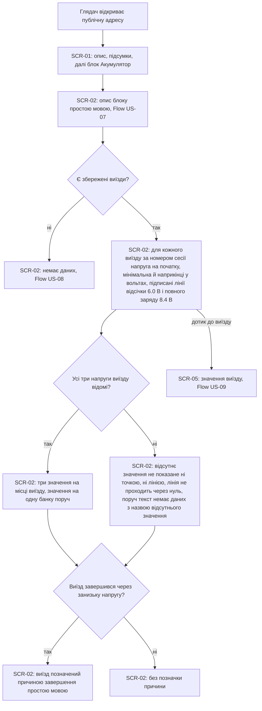

Глядач відкриває адресу й на SCR-01 під підсумками знаходить блок «Акумулятор» (SCR-02); над ним стоїть опис (флоу US-07). Якщо виїздів немає, блок показує «немає даних» (флоу US-08). Інакше для кожного виїзду за номером сесії видно три напруги: на початку, мінімальну й наприкінці, у вольтах, а значення в перерахунку на одну банку доступне поруч; дві опорні лінії, відсічка 6.0 В і повний заряд 8.4 В, підписані. Якщо ровер не передав одну чи кілька напруг виїзду, це значення не малюється ні точкою, ні лінією, лінія не опускається до нуля, а поруч написано «немає даних» з назвою відсутнього значення. Виїзд, що завершився через занизьку напругу, позначено причиною простою мовою; виїзди з іншими причинами позначки не мають. Дотик до виїзду відкриває його значення (SCR-05, флоу US-09).

### Flow: US-02 — Просадка під навантаженням

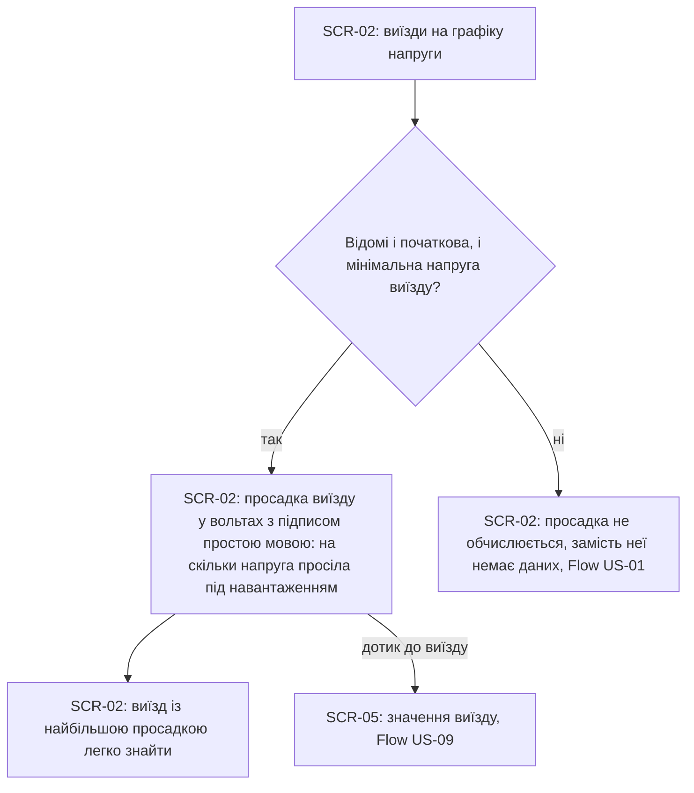

Власник дивиться SCR-02 і для кожного виїзду, де відомі і початкова, і мінімальна напруга, бачить просадку (початкова мінус мінімальна) у вольтах, підписану простою мовою. Виїзд із найбільшою просадкою легко знайти, спосіб виділення визначить `screens`. Якщо хоч однієї з двох напруг немає, просадка не обчислюється, а на її місці «немає даних», і це не нуль (флоу US-01).

### Flow: US-03 — Перешкоди за датчиками

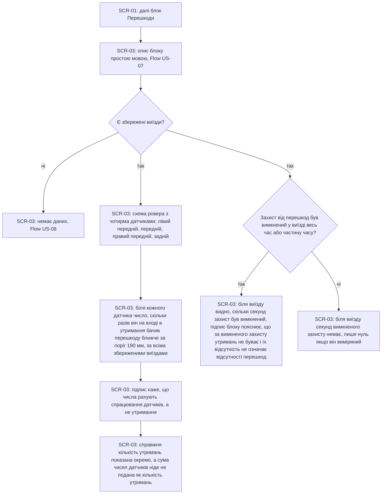

Глядач бачить у блоці «Перешкоди» (SCR-03) схему ровера з чотирма датчиками: лівим переднім, переднім, правим переднім і заднім. Біля кожного стоїть число: скільки разів цей датчик на вході в утримання бачив перешкоду ближче за поріг 190 мм, за всіма збереженими виїздами. Підпис прямо каже, що це спрацювання датчиків, а не утримання, бо кілька датчиків можуть бачити перешкоду в одному утриманні; тому сума чисел ніде не подана як кількість утримань, а справжня кількість утримань показана окремо. Для кожного виїзду, де захист від перешкод був вимкнений весь час чи частину, біля виїзду видно секунди вимкненого захисту, а підпис блоку пояснює, що тоді утримань не буває і їх відсутність не означає відсутності перешкод. Якщо виїздів немає, блок показує «немає даних» (флоу US-08).

### Flow: US-04 — Наскільки близько перешкода

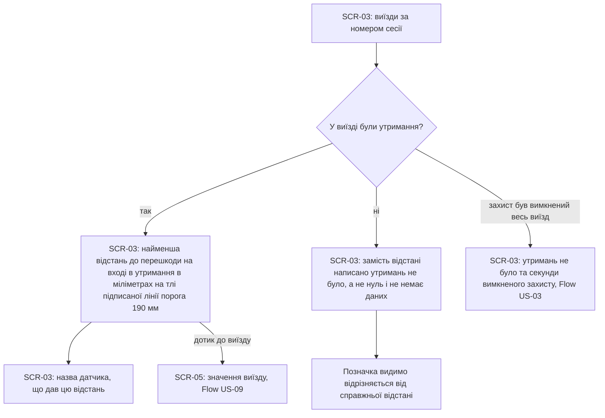

Власник дивиться SCR-03 і для кожного виїзду, де були утримання, бачить за номером сесії найменшу відстань до перешкоди на вході в утримання в міліметрах, на тлі підписаної лінії порога 190 мм, і назву датчика, що її дав. Для виїзду без утримань замість відстані написано «утримань не було»: це не нуль і не «немає даних», і така позначка видимо відрізняється від справжньої відстані. Якщо в такому виїзді захист від перешкод був вимкнений, поруч видно секунди вимкненого захисту (флоу US-03), бо без цього «утримань не було» читалося б як «перешкод не було».

### Flow: US-05 — Лівий проти правого

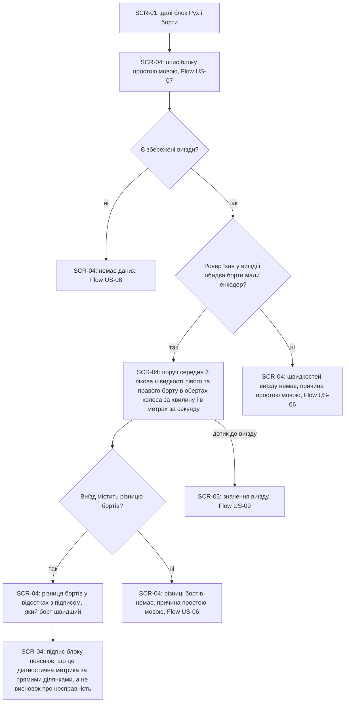

Власник дивиться блок «Рух і борти» (SCR-04). Для виїздів, де ровер їхав і обидва борти мали енкодер, поруч видно середню й пікову швидкості лівого та правого борту: в обертах колеса за хвилину і в метрах за секунду, тож борти легко порівняти. Якщо виїзд містить різницю бортів, вона подана у відсотках з підписом, який борт швидший; підпис блоку пояснює, що це діагностична метрика за прямими ділянками, а не висновок про несправність. Коли швидкостей або різниці немає, діє флоу US-06. Якщо виїздів немає, блок показує «немає даних» (флоу US-08).

### Flow: US-06 — Чому немає швидкості

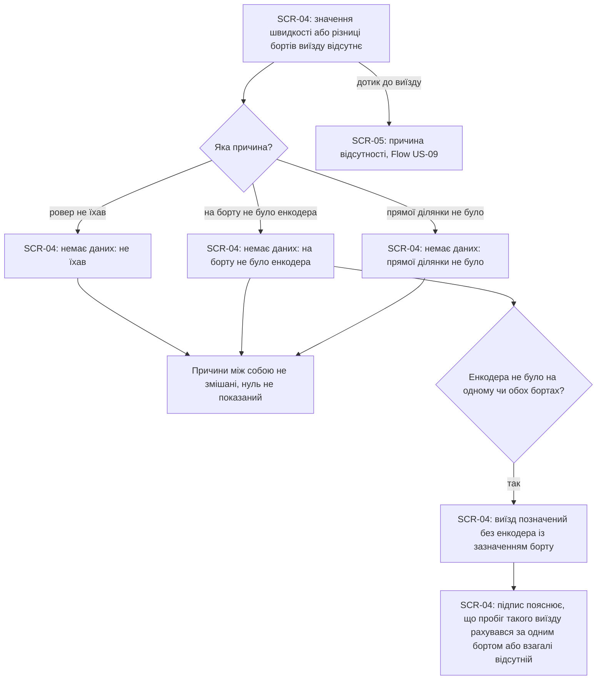

Коли для виїзду відсутня швидкість або різниця бортів, Власник бачить «немає даних» з причиною простою мовою: «не їхав», «на борту не було енкодера» або «прямої ділянки не було». Причини між собою не змішуються, і замість значення ніколи не стоїть нуль, щоб відсутність виміру не прочитали як нульову швидкість чи несправність. Якщо енкодера не було на одному чи обох бортах, виїзд додатково позначений «без енкодера» із зазначенням борту, а підпис пояснює, що пробіг такого виїзду рахувався за одним бортом або взагалі відсутній. Причину видно й після дотику до виїзду (SCR-05).

### Flow: US-07 — Графіки зрозумілі без контексту

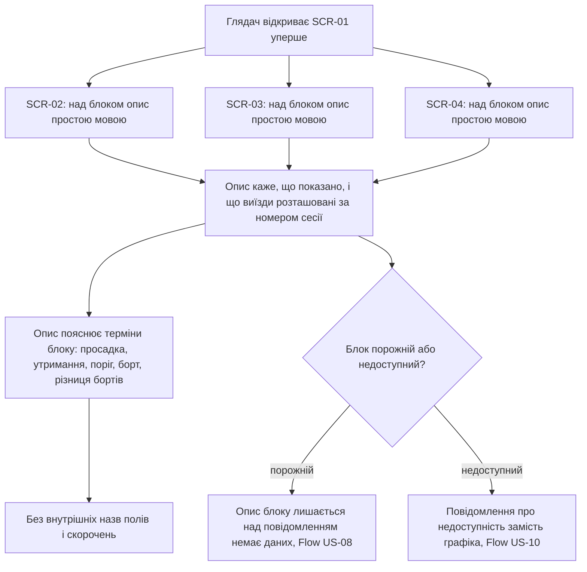

Глядач, який відкриває сторінку вперше, над кожним із трьох блоків знаходить короткий опис простою мовою: що показано, що виїзди розташовані за номером сесії, і що означають терміни, які зустрічаються саме в цьому блоці: просадка в «Акумуляторі», утримання й поріг у «Перешкодах», борт і різниця бортів у «Русі і бортах». Внутрішніх назв полів і скорочень в описах немає. Опис лишається над порожнім блоком (разом із «немає даних»); для недоступного блоку діє флоу US-10.

### Flow: US-08 — Графіки не обманюють

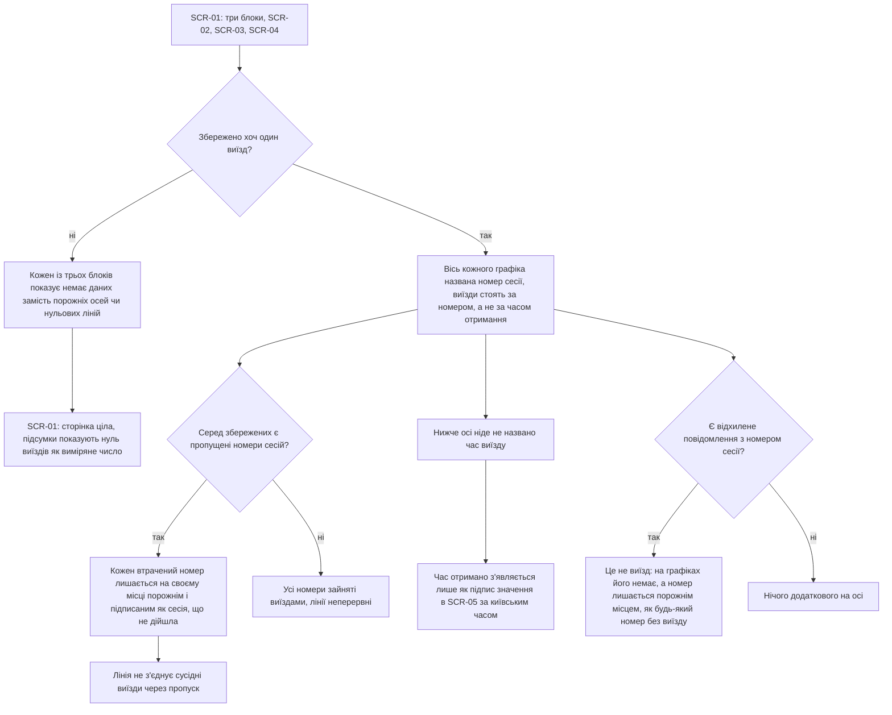

Якщо жодного виїзду ще не збережено, кожен із трьох блоків показує «немає даних» замість порожніх осей чи нульових ліній, сторінка лишається цілою, а підсумки показують нуль виїздів як виміряне число. Коли виїзди є, на всіх графіках вісь названа «номер сесії», а виїзди стоять за номером, а не за часом отримання; про час виїзду ніде не йдеться, а «отримано» з'являється тільки як підпис значення (SCR-05), за київським часом. Кожен пропущений номер лишається на осі на своєму місці порожнім і підписаним як сесія, що не дійшла, а лінія не з'єднує сусідні виїзди через пропуск. Відхилене повідомлення виїздом не вважається і на графіках не з'являється; його номер, якщо він був, лишається порожнім місцем, як будь-який номер без виїзду (відкрите питання spec §8, дедлайн до `/sdd:data-model`).

### Flow: US-09 — Графіки на телефоні

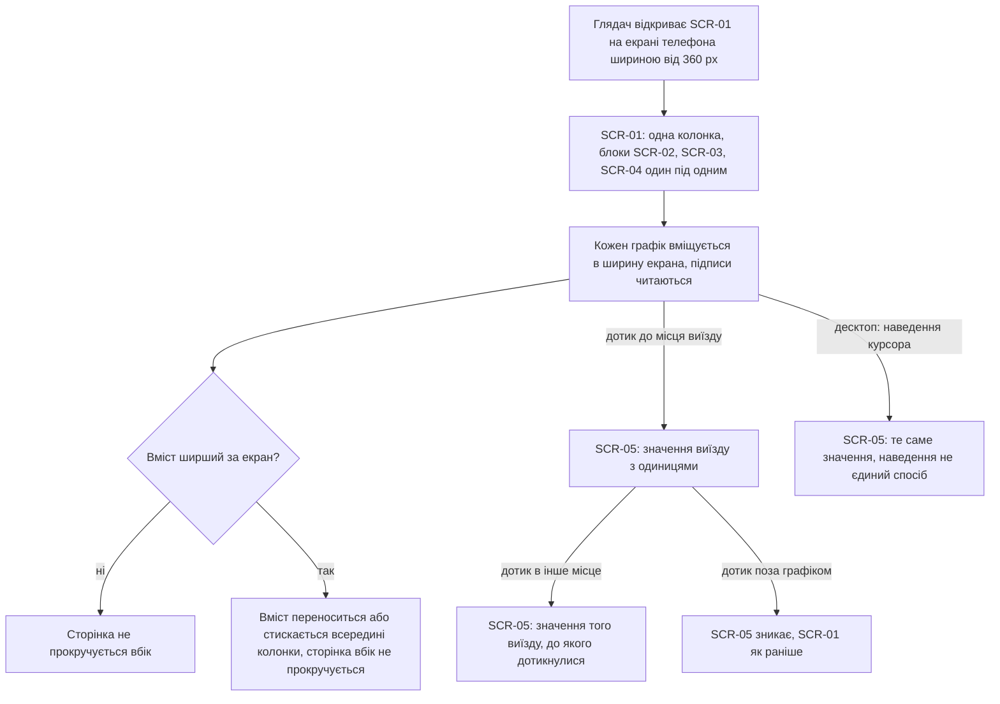

Глядач відкриває сторінку на телефоні: блоки йдуть одною колонкою один під одним, кожен графік вміщується в ширину екрана, підписи читаються, сторінка не прокручується вбік (як саме підписи й значення переносяться, вирішить `screens`). Значення виїзду з'являється дотиком до його місця на графіку (SCR-05), а не лише наведенням курсора: наведення на десктопі показує те саме. Дотик в інше місце показує значення іншого виїзду, а дотик поза графіком ховає значення.

### Flow: US-10 — Лише читання, без зайвого

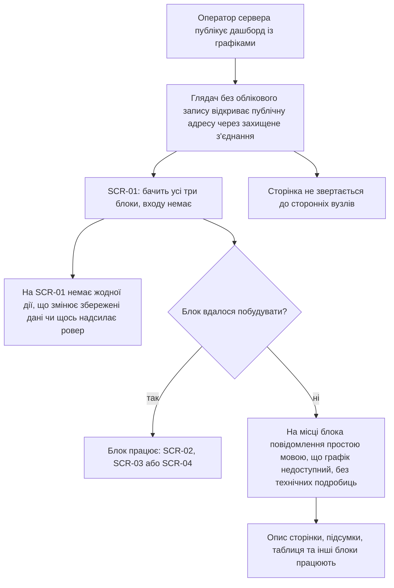

Оператор публікує дашборд, і Глядач без облікового запису відкриває публічну адресу через захищене з'єднання: він бачить усі три блоки (SCR-01), але не має жодної дії, що змінює збережені дані чи щось надсилає ровер. Якщо один блок не вдалося побудувати, на його місці стоїть повідомлення простою мовою, що графік недоступний, без технічних подробиць; опис сторінки, підсумки, таблиця й інші блоки працюють. Частина AC-21, яку не видно в UI (збереження нових звітів триває, навіть якщо дашборд зупинено; відсутність звернень до сторонніх вузлів), у флоу не малюється й перевіряється тестами NFR.

### Flow: US-11 — Свіжі виїзди на графіках

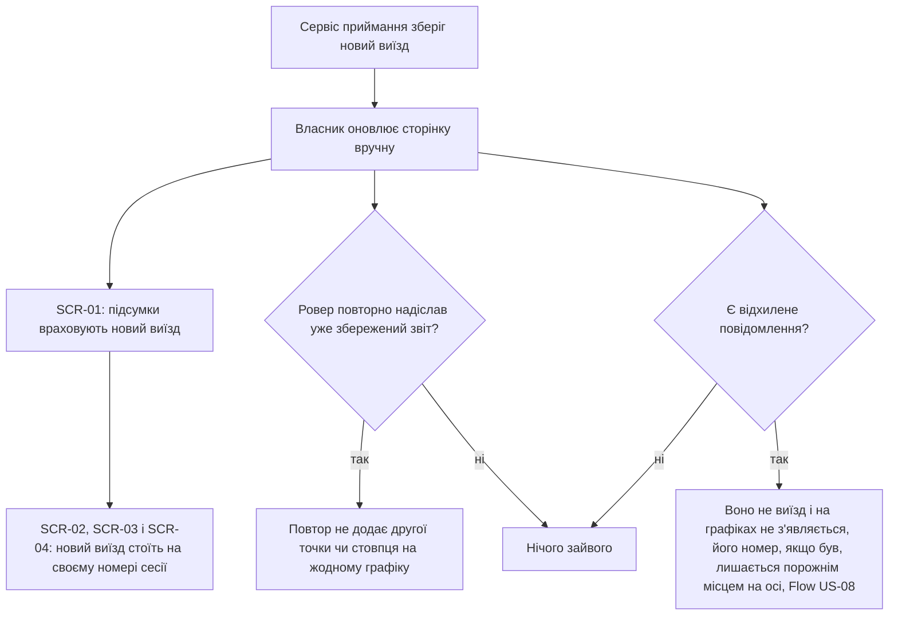

Коли сервіс приймання зберігає новий виїзд, Власник оновлює сторінку вручну (автооновлення немає): підсумки враховують виїзд, а в кожному з трьох блоків він стоїть на своєму номері сесії. Якщо ровер повторно надіслав уже збережений звіт, після оновлення на жодному графіку не з'являється другої точки чи стовпця. Відхилене повідомлення виїздом не вважається і на графіках не з'являється; його номер, якщо він був, лишається порожнім місцем на осі (флоу US-08).

## AC coverage

| AC | Shown by | Notes |
|---|---|---|
| AC-01 | Flow US-01 → вузли E, G | Три напруги у вольтах, значення на одну банку, підписані лінії 6.0 В і 8.4 В |
| AC-02 | Flow US-02 → гілка B (так), вузли C, E | Просадка у вольтах, виїзд із найбільшою просадкою легко знайти |
| AC-03 | Flow US-01 → гілка F (ні), вузол H; Flow US-02 → гілка B (ні), вузол D | Відсутня напруга не точка й не лінія, просадка не обчислюється, «немає даних» з назвою значення |
| AC-04 | Flow US-01 → гілка I (так / ні), вузли J, K | Позначка причини лише для занизької напруги |
| AC-05 | Flow US-03 → вузли D, E | Схема з чотирма датчиками і числами за всіма виїздами |
| AC-06 | Flow US-03 → вузли F, G | Підпис «спрацювання датчиків, а не утримання», справжня кількість утримань окремо |
| AC-07 | Flow US-04 → гілка B (так), вузли C, D | Відстань у мм на тлі лінії 190 мм і датчик |
| AC-08 | Flow US-04 → гілка B (ні), вузли E, F | «утримань не було», відмінне від нуля й від «немає даних» |
| AC-09 | Flow US-03 → гілка H (так), вузол I; Flow US-04 → гілка G | Секунди вимкненого захисту й підпис про відсутність утримань |
| AC-10 | Flow US-05 → гілка D (так), вузол E | Середня й пікова швидкості обох бортів в об/хв і м/с |
| AC-11 | Flow US-05 → гілка F (так), вузли G, H | Різниця бортів у %, який борт швидший, підпис про діагностичну метрику |
| AC-12 | Flow US-06 → гілка B, вузли C, D, E, F | Три окремі причини, не нуль |
| AC-13 | Flow US-06 → гілка G (так), вузли H, I | «без енкодера» із зазначенням борту і пояснення про пробіг |
| AC-14 | Flow US-07 → вузли B, C, D, E, F, G | Опис над кожним блоком, терміни простою мовою, без внутрішніх назв |
| AC-15 | Flow US-08 → гілка F (так), вузли G, H | Порожнє підписане місце для втраченого номера, лінія не з'єднує через пропуск |
| AC-16 | Flow US-08 → вузли E, J, K | Вісь «номер сесії», час виїзду ніде не названо, «отримано» лише підписом значення за київським часом |
| AC-17 | Flow US-08 → гілка B (ні), вузли C, D | Кожен блок «немає даних», підсумки показують нуль виїздів |
| AC-18 | Flow US-09 → вузли B, C, D, G | Ширина екрана, без прокручування вбік, значення дотиком |
| AC-19 | Flow US-10 → гілка E (ні), вузли G, H | Повідомлення замість блока, решта сторінки працює |
| AC-20 | Flow US-10 → вузли C, D | Без входу, жодної дії запису; те, що ровер від дашборду нічого не отримує, не видно в UI |
| AC-21 | Flow US-10 → вузли B, C, I | Видима частина: сторінка відкривається за публічною адресою через захищене з'єднання. N/A для решти: збереження звітів за зупиненого дашборду й відсутність сторонніх вузлів не UI-потік, перевіряються тестами NFR |
| AC-22 | Flow US-11 → вузли B, C, D | Новий виїзд на своєму номері у трьох блоках і в підсумках |
| AC-23 | Flow US-11 → гілки E (так), H (так); Flow US-08 → гілка L (так) | Дубль не додає точки, відхилене повідомлення не виїзд, його номер порожнє місце |

## Assumptions ledger (easy depth)

Рівень Easy: флоу записано без поштучного підтвердження, власник може ветувати будь-який зі списку. Глибина й позиція платформи підтверджені власником на початку стадії (easy; mobile-first, як у каноні).

- US-01: значення на одну банку подано поруч зі значенням у вольтах, спосіб (підпис, друге значення, підказка) визначає `screens`; хто з трьох напруг відсутня — окремий підпис «немає даних» біля виїзду, а не спільний для виїзду.
- US-02: «легко знайти» виїзд із найбільшою просадкою — вимога без способу (виділення, сортування, підпис) — рішення `screens`.
- US-03: схема датчиків одна на весь блок і не залежить від виїзду; секунди вимкненого захисту стоять біля виїзду, а не на схемі. Якщо жоден виїзд не має лічильників датчиків, схема, за конституцією №4, показує «немає даних», а не нулі: на підтвердження власнику й `screens` (у spec окремого AC на цей випадок немає).
- US-04: виїзд із вимкненим на весь час захистом показується як «утримань не було» плюс секунди вимкненого захисту; окремої третьої позначки немає (spec AC-08, AC-09). Невідома дашборду назва датчика показується безпечно як текст (spec §6.1).
- US-05: порядок «спочатку швидкість, потім різниця» узято з AC-10 і AC-11; одиниці об/хв і м/с показуються разом, а не перемикачем.
- US-06: у spec не сказано, яку причину показувати, якщо для одного значення діють кілька (наприклад, не їхав і без енкодера); флоу малює їх як альтернативи, порядок пріоритету потребує рішення в `screens` або `clarify` перед `plan-tests`.
- US-07: опис блоку лишається над «немає даних» (порожній стан) і замінюється повідомленням у стані «недоступний» разом із графіком; spec це прямо не розрізняє — на підтвердження в `screens`.
- US-08: напрям осі (зростання номера зліва направо) прийнято за звичайний для графіка, а таблиця виїздів лишається за спаданням (dashboard-summary AC-03); на підтвердження в `screens`. Номер відхиленого повідомлення позначається як будь-який номер без виїзду (spec §8, останнє питання, дедлайн до `/sdd:data-model`).
- US-09: дотик в інше місце переносить значення на інший виїзд, дотик поза графіком його ховає; spec вимагає лише дотик (AC-18), решта — припущення взаємодії, деталі в `screens`.
- US-10: Оператор сервера у флоу лише публікує; усе, що поза UI в AC-20 і AC-21 (права ролі БД, HTTPS-розгортання, ізоляція приймання), проходить тестами, а не флоу.
- US-11: автооновлення немає (spec §3), оновлення лише вручну; новий виїзд з'являється при першому оновленні (NFR «Актуальність»).
- Усі: статус «завантаження» окремого екрана не створює, це стан блока (простий текстовий заповнювач за `docs/design-system.md`).
