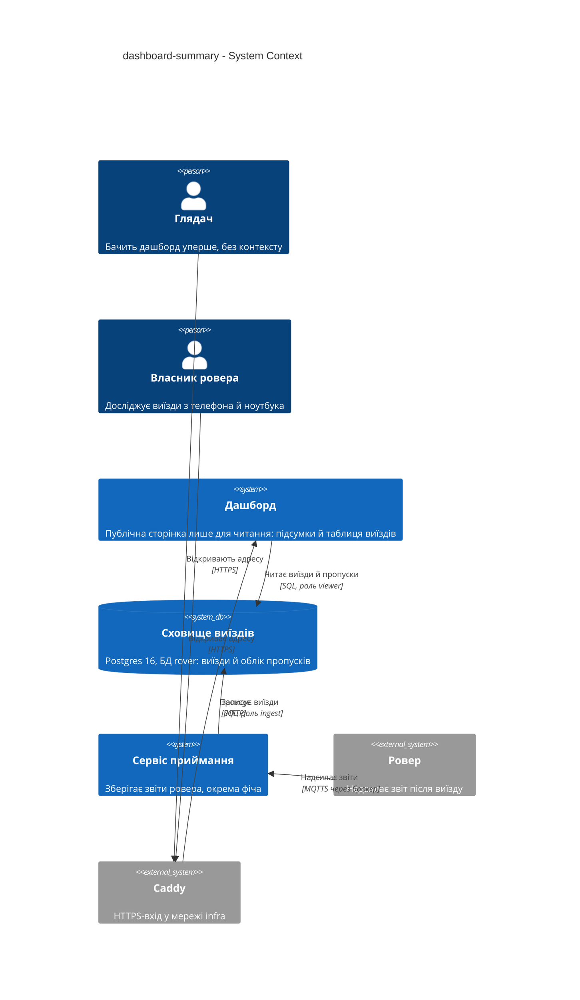
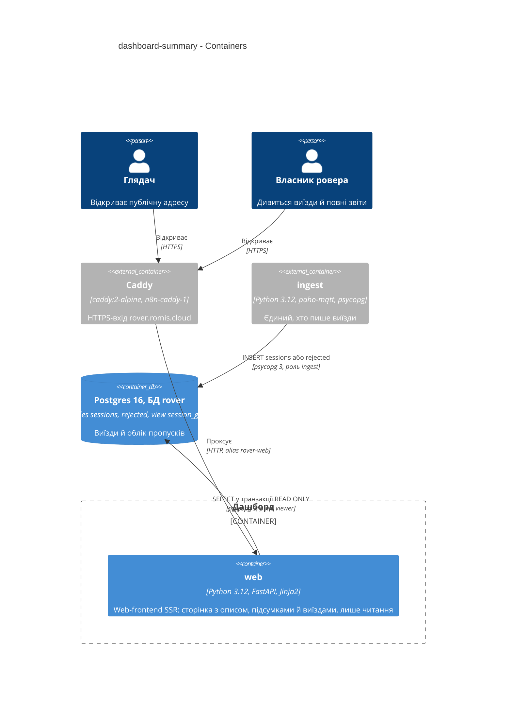
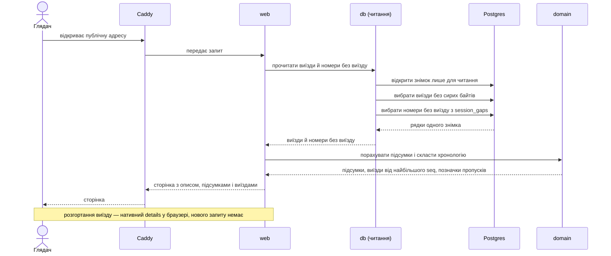
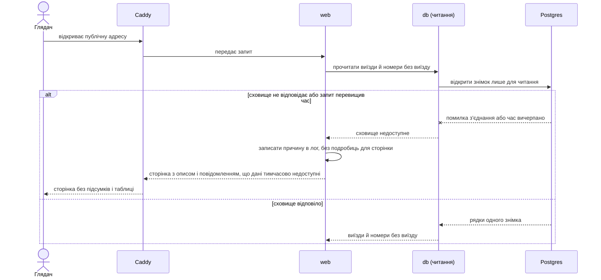

# Software Architecture Document — dashboard-summary

<!-- 12 Arc42 sections. Empty section → <!-- N/A: <one-line reason> -->. -->
<!-- C4 Context (L1) lives inline in §3. C4 Container (L2) lives inline in §5. -->
<!-- Numbers in §10 come VERBATIM from spec.md §6 NFR — no inventing, no rounding. -->

> Фундаментальні ADR проєкту (`docs/adr/0001…0003`) тут називаються «фундаментальний ADR-NNNN». ADR цієї фічі лежать у `adr/` і нумеруються окремо (0001…0002).

## 1. Introduction and goals

**Intent.** Перший екран дашборду для Глядача та Власника ровера: одна публічна сторінка лише для читання з коротким описом простою мовою, підсумками за всіма збереженими виїздами і списком виїздів від найновіших до найстаріших, де кожен виїзд можна розгорнути до повного звіту. Сторінка читає те, що вже зберіг `ingest`, нічого не змінює і не залежить від зовнішньої мережі (spec §1, §2).

**Top-3 quality goals (1-liners; full scenarios in §10):**

1. **Достовірність відсутнього** — жодне «немає даних» не показано числом, час названо «отримано», пропуски номерів сесій видно, відхилені не рахуються виїздами.
2. **Безпечна й автономна публічна поверхня** — лише читання, без зовнішніх вузлів, зупинка дашборду не зупиняє збереження звітів.
3. **Швидка, свіжа й придатна на телефоні сторінка** — формується без кешу даних і читається в одну колонку без прокручування вбік.

**Stakeholders.**

| Role | Interest | Sign-off owner? |
|---|---|---|
| Глядач | Бачить дашборд уперше й без контексту: потрібні пояснення простою мовою і сторінка, що не ламається | No |
| Власник ровера | Бачить кожен виїзд і його повний звіт; відсутнє значення не плутається з нулем, втрати видно | No |
| Оператор сервера | Публікує сторінку через Caddy, стежить, щоб збій дашборду не зачіпав приймання | No |
| Tech Lead (12romis) | Затвердження SAD | Yes |

- Decision override: `web` читає таблицю `sessions` напряму, а не лише SQL-представлення — rationale: роль `viewer` уже має `SELECT`, сторінка й так завантажує всі виїзди, а підсумки з тих самих рядків узгоджені з таблицею без нової міграції; фундаментальний ADR-0003 лишається чинним для агрегацій, яких сторінка не завантажує (feature ADR-0001).
- Decision override: розгорнутий звіт показується з `sessions.payload` (jsonb), а не з точних байтів `raw` — rationale: AC-05 («так, як його надіслав ровер») виконується на рівні полів і значень; порядок ключів і пробіли jsonb нормалізує, дослівна копія лишається в `raw`, який сторінка не читає (власник погодив під час critic-resolution 2026-10-24).

## 2. Constraints

**Technical.**
- Python 3.12 (образ `python:3.12-slim`), FastAPI + Jinja2 (шаблони на сервері), `psycopg` 3 з сирим SQL без ORM (`docs/architecture-map.md`, фундаментальний ADR-0001, ADR-0003; відступ щодо читання `sessions` — §1 ¶4).
- Postgres 16 у наявному контейнері `postgres`, БД `rover`; дашборд підключається роллю `viewer` (лише `SELECT` на `sessions`, `rejected`, `session_gaps` — міграції `0002`–`0004`); запису немає (конституція №10, №11).
- Шари `domain` ← `db` ← `web`; `web` не імпортує `ingest` (фундаментальний ADR-0002). Один образ, два сервіси (фундаментальний ADR-0001).
- Власний CSS у `web/static/app.css` без Tailwind і збірки; без CDN і без шрифтів з мережі; бібліотеку графіків ця фіча не додає (`docs/design-system.md`, spec §3).
- Мобільна розкладка обов'язкова: одна колонка, без прокручування вбік (рішення власника №13, `docs/design-system.md` §Platform posture).
- Контракт `rover.session.v1` канонічний (`docs/contracts/events.md`): звіт ≤ 1024 байти, тож повний звіт одного виїзду не перевищує цього розміру.

**Organisational.**
- Один розробник. Презентація 2026-10-26 (понеділок) — жорсткий дедлайн; цей екран — пріоритет разом із прийманням (`docs/idea-brief.md` §6, spec §1).
- Публічна адреса `rover.romis.cloud` потребує запису DNS від власника до розгортання (`docs/architecture-map.md`, spec §8).

**Conventions.**
- `docs/constitution.md` (зокрема №3, №4, №5, №6, №10, №11, №12, №14) і `docs/architecture-map.md` §Conventions; доступ до БД — сирий SQL, параметризовані запити.
- Тести — реальні фікстури `tests/fixtures/` (seq 26 і 27), конституція №15; `mypy --strict`, `ruff`.
- Природний ключ виїзду `(mac, seq)`; відсутнє значення — `NULL` у БД, `None` у `domain`, «немає даних» в інтерфейсі.

**Regulatory / external.**
- Дані публічні, персональних даних немає (spec §6.1); автентифікації немає — рішення власника №4 і конституція №12. Security review: Required (spec §6.1) — перед публікацією перевірити HTTPS-вхід, відсутність опублікованих портів, права `viewer`.
- Секрети лише в `~/.config/claude-secrets/rover.env` / `.env` поза git; у compose для `web` передається лише `WEB_DATABASE_URL`.

## 3. Context and scope

Дашборд — сторінка, яку Глядач і Власник ровера відкривають у браузері на телефоні чи ноутбуці. Вона читає з сховища виїзди, які зберіг сервіс приймання (`ingest`) зі звітів ровера, і нічого не відправляє назад: ні в сховище, ні ровером (конституція №11). Межа довіри проходить по публічній адресі: усе, що надходить з мережі, недовірене; усе, що йде зі сховища (рядок прошивки, причина завершення), показується як текст, а не як розмітка (spec §6.1).

<!-- brownfield: код каркаса `web` (лише `/healthz`), `db/sessions.py` (запис), міграції 0002–0004 (таблиці `sessions`, `rejected`, представлення `session_gaps`), `ingest` змерджено та працює в проді; `docs/architecture-map.md` описує цільовий стан до scaffold (reflects_commit e52fadb) — розбіжностей із кодом, що стосуються цієї фічі, немає, окрім того, що `env_file` у compose уже замінено на `environment:`. -->

**External systems (in / out):**

| Actor or system | Type | Interaction |
|---|---|---|
| Глядач | Person | Відкриває публічну адресу, читає опис, підсумки, таблицю виїздів |
| Власник ровера | Person | Те саме, плюс розгортає виїзд до повного звіту й оновлює сторінку |
| Оператор сервера | Person | Публікує сервіс через Caddy, ставить DNS, зупиняє й запускає `web` (поза сценаріями сторінки) |
| Caddy (`n8n-caddy-1`) | System (external) | Приймає HTTPS на `rover.romis.cloud`, проксує до `web` |
| Сервіс приймання `ingest` | System (internal, фіча ingest) | Єдиний, хто пише виїзди; з дашбордом напряму не взаємодіє, зв'язок лише через сховище |
| Сховище виїздів (Postgres 16, БД `rover`) | System (internal) | Віддає дашборду виїзди й облік пропусків; доступ лише для читання |
| Ровер | System (external) | Надсилає звіти до `ingest` через брокер; від дашборду нічого не отримує |

**C4 Context (L1):**



## 4. Solution strategy

**Target surface: `web-frontend`.** Фіча вводить єдину сторінку в браузері для Глядача й Власника ровера (spec §1 «для кого», §4 ролі, `ux-flows.md`: SCR-01, SCR-02). Окремого програмного API немає: сторінку формує той самий процес `web`, що віддає й HTML, тож `backend-service` другою поверхнею не оголошується (поки `/healthz` — не контракт для споживача). Одна поверхня, тож рішення не дає ADR; у frontmatter `target_surfaces: [web-frontend]`.

**UI-архітектура: SSR без скриптів** — сторінка формується на сервері шаблоном Jinja2, клієнтського стану й роутингу немає (одна сторінка, `ux-flows.md` §Platform decisions); єдина взаємодія — розгортання рядка нативним `<details>`. Вибір «усе в сторінці чи підвантаження при розгортанні» — feature ADR-0002.

**Top strategic choices (the seeds for ADRs):**

1. **Один знімок читання, підсумки рахує `domain`** — запит сторінки відкриває одну транзакцію лише для читання, читає виїзди й облік пропусків, і чисті функції `domain` будують із цих самих рядків підсумки та список. Таблиця й підсумки узгоджені за побудовою, правило «`NULL` ≠ 0» живе в одному тестованому місці, нової міграції немає (QG-1, QG-3) — feature ADR-0001.
2. **Повний звіт у сторінці, розгортання без скриптів** — кожен виїзд є елементом `<details>`, звіт вбудований у HTML. Це тримає суворий CSP без скриптів, одну точку входу і працює без JS (QG-2), ціною ваги сторінки, що росте з кількістю виїздів — feature ADR-0002.
3. **Дашборд лише читає на трьох рівнях** — роль БД `viewer` без права запису, транзакція `READ ONLY`, у застосунку немає жодного маршруту з побічним ефектом (конституція №10, №11, AC-14).
4. **Збій сховища не ламає сторінку** — недоступність БД ловиться на межі `web`, сторінка віддається з описом і повідомленням замість даних; технічні подробиці йдуть лише в лог (AC-12).

Тактичні рішення цього етапу (без ADR, бо відкат — години, а не дні): з'єднання з БД на запит без пулу, з таймаутом підключення й таймаутом виконання запиту, меншими за таймаут Caddy, щоб недоступне сховище давало AC-12, а не зависання (значення вибирають `tasks`/Оператор, як у ingest, а не вимога специфікації); список виїздів — елементи `<details>`, а не `<table>` (рядок `<tr>` не може бути розгортуваним, а таблиця в 11 колонок не вміщується в 360 px); імена файлів у §5 — пропозиція для `tasks`; `HTTP 503` при недоступному сховищі; назва «RomisRover» для `288485922c94` (рішення власника №10) — константа в `web`, інші `mac` показуються як є; порядок рядків — `seq` ↓, потім `mac`; заголовки безпеки (CSP `default-src 'self'`, `Cache-Control: no-store`, `X-Content-Type-Options: nosniff`) ставить сам застосунок, щоб їх перевіряв тест; `openapi_url` вимкнено (як уже вимкнено `/docs` і `/redoc`); київський час через `zoneinfo`, `tzdata` додається в залежності, бо в `python:3.12-slim` бази зон може не бути.

## 5. Building block view

Прості шари за фундаментальним ADR-0002: чистий `domain` (підсумки, хронологія, класифікація причини завершення), `db` (читання сирим SQL), `web` (маршрут, шаблони, підписи, київський час). Новий модуль не створюється, змінюються наявні `domain`, `db`, `web`; міграцій і змін `ingest` немає. Правило залежностей: `domain` нічого не імпортує з проєкту, `db` залежить від `domain`, `web` від обох.

**Internal decomposition** (імена файлів — пропозиція для `tasks`):

```
src/rover_telemetry/
├── domain/
│   ├── report.py          # наявний, розбір звіту (ingest)
│   └── dashboard.py       # StoredSession, Summary, Total(sum, missing), EndReason, build_timeline; без I/O
├── db/
│   ├── sessions.py        # наявний, лише INSERT (ingest)
│   └── reading.py         # read_snapshot(conn) -> (виїзди, номери без виїзду); транзакція READ ONLY
├── web/
│   ├── app.py             # маршрут сторінки, заголовки безпеки, 503 при недоступному сховищі
│   ├── formatting.py      # «отримано» у Europe/Kyiv, одиниці, підписи причин, назва ровера
│   ├── templates/         # base.html, dashboard.html, макроси: картка показника, «немає даних»
│   └── static/app.css     # токени й стилі (design-system.md)
└── config.py              # WebSettings: WEB_DATABASE_URL (наявний)
docker-compose.yml         # сервіс web: network alias rover-web
pyproject.toml             # залежність tzdata
```

**C4 Container (L2):**



## 6. Runtime view

Два керівних сценарії; решту AC (порожнє сховище, нуль проти «немає даних», пропуски, відхилені, дубль) покриває стадія `sequences`.

**Critical flow 1: показ сторінки з даними (AC-01, AC-03, AC-08, AC-17)**



**Critical flow 2: сховище недоступне (AC-12)**



## 7. Deployment view

Сервіс `web` — уже оголошений сервіс у `docker-compose.yml` (той самий образ `rover-telemetry`, команда `python -m rover_telemetry.web`, мережа `infra`, `restart: unless-stopped`); порти на хост не публікуються (конституція №12). Для цієї фічі додаються: мережевий alias `rover-web` (ім'я `web` у спільній мережі `infra` може збігтися з чужим сервісом), `tzdata` у залежностях образу й блок у `/opt/n8n/Caddyfile`:

```
rover.romis.cloud {
    reverse_proxy rover-web:8000
}
```

Одна репліка. `web` залежить від Postgres, але не від `ingest`: зупинка `web` не зупиняє збереження звітів (AC-15), перевіряється зупинкою контейнера, надсиланням звіту й читанням збереженого. Рядок підключення `WEB_DATABASE_URL` (роль `viewer`) роздається лише контейнеру `web`. Перед публікацією: запис DNS для `rover.romis.cloud` (spec §8, у власника) і перезавантаження Caddy за процедурою стеку n8n. Роль `viewer` розумно обмежити за кількістю одночасних підключень (`ALTER ROLE viewer CONNECTION LIMIT …`, значення вибирає Оператор під час розгортання), щоб навал запитів до публічної сторінки не вичерпав підключення, потрібні `ingest`.

**Monitoring:**
- Метрики: окремого сервера метрик немає; логи `web` через `docker logs` (запит, причина недоступності сховища, без вмісту звітів і паролів).
- Алерти: немає (рішення власника №12 — сповіщення не в першій версії).
- Перевірка життя: наявний `/healthz`; доступ ззовні перевіряється відкриттям публічної адреси.

**Scaling thresholds:**
- Спека розрахована на ≤ 1000 збережених виїздів (spec §6); сторінка містить усі виїзди разом зі звітами (до 1024 байтів на виїзд за контрактом), тому вага сторінки росте лінійно.
- Понад ≤ 1000 виїздів потрібне рішення про обмеження таблиці (spec §8, відкрите питання «після презентації 2026-10-26»): розбиття на сторінки або підвантаження звіту при розгортанні (змінює feature ADR-0002).

## 8. Crosscutting concepts

| Concept | Convention | Where defined |
|---|---|---|
| Logging | Рядки `key=value` у stdout; помилка сховища логується повністю (клас і текст), на сторінку потрапляє лише загальне повідомлення; вмісту звітів і паролів у логах немає | тут, за прикладом ingest |
| Authentication / AuthZ | Автентифікації немає (конституція №12, рішення №4). Право читання забезпечує роль Postgres `viewer` (без `INSERT/UPDATE/DELETE`), транзакція `READ ONLY` і відсутність маршрутів з побічним ефектом; дозволений лише `GET` | конституція №10, №11, feature ADR-0001 |
| Error handling | `psycopg.OperationalError`, перевищення таймаутів підключення чи запиту та інші збої читання ловляться на межі `web`: повна сторінка з описом і блоком «дані тимчасово недоступні», статус 503, без технічних подробиць; невідомий маршрут — стандартна відповідь FastAPI | `docs/architecture-map.md`, spec AC-12 |
| NULL vs 0 | `NULL` → `None` у `domain` → «немає даних» (макрос, окремий вигляд); виміряний нуль показується як 0; підсумок = сума лише за відомими значеннями + кількість виїздів без даних, а якщо відомих немає, «немає даних»; уніфікована структура `Total(sum, missing)` для пробігу, часу руху й утримань | конституція №4, feature ADR-0001 |
| Time | Лише `received_at`, підпис «отримано», пояс Europe/Kyiv (`zoneinfo`); слів «час виїзду» чи «час сесії» немає; порядок рядків не залежить від часу | конституція №5, рішення власника №11 |
| Lost sessions | Позначка «виїзду з цим номером немає» на місці кожного номера з `session_gaps`; відхилене повідомлення з `rejected` не читається, тож номер не відрізняється від втраченого (AC-16) | конституція №6, ingest ADR-0004 |
| Output escaping | Усе, що йде зі звіту, виводиться як текст: автоекранування Jinja2 увімкнено, фільтр `safe` не використовується, `payload` рендериться як екранований текст | spec §6.1 |
| Security headers | `Content-Security-Policy: default-src 'self'` (без inline-скриптів і стилів), `Cache-Control: no-store`, `X-Content-Type-Options: nosniff`, `Referrer-Policy: no-referrer`; жодних запитів до сторонніх вузлів | тут, spec §6 |
| Caching | Немає: кожен запит читає актуальний знімок, `Cache-Control: no-store` (spec §6 «кешування даних — 0 с») | spec §6 |
| Configuration / secrets | `WebSettings.from_env()`: лише `WEB_DATABASE_URL`; значення поза git, назви в `.env.example` | конституція №9 |
| Internationalisation | N/A — єдина мова інтерфейсу українська, підписи простою мовою без внутрішніх термінів | — |

## 9. Architecture decisions

| # | Title | Status | Section |
|---|---|---|---|
| 0001 | Compute dashboard summary in domain from one read-only snapshot | Accepted | §4 |
| 0002 | Render reports inline in native details without scripts | Accepted | §4 |

ADR files live under `docs/features/dashboard-summary/adr/NNNN-<title>.md`.

## 10. Quality requirements

Числа нижче — дослівно зі spec §6; сама spec позначає їх припущеннями, які власник підтверджує до `/sdd:plan-tests` (spec §8).

**QG-1. Достовірність відсутніх значень**
- **When:** у сховищі є виїзд без пробігу чи напруги, виїзд із виміряним нульовим пробігом, пропуски в нумерації сесій і відхилені повідомлення; сторінка показує таблицю й підсумки.
- **Then:** 0 випадків, коли «немає даних» показано числом; нуль пробігу показано як 0; підсумок пробігу — сума лише за відомими значеннями з кількістю виїздів без даних, а без жодного відомого — «немає даних»; відхилені виїздами не рахуються; час має підпис «отримано».
- **How verify:** тест на фікстурах seq 26 і 27 і на реальних сесіях (таблиця та підсумки); юніт-тест `domain.dashboard` і інтеграційний тест на реальному Postgres.

**QG-2. Безпечна й автономна публічна поверхня**
- **When:** Глядач відкриває сторінку без облікового запису; `web` зупинено на час надсилання звіту; у роботі дашборду трапляється помилка.
- **Then:** 0 запитів до сторонніх вузлів; дашборд не має жодної дії запису, сховище відмовляє будь-якій спробі запису від його ролі; зупинка дашборду не зупиняє збереження звітів.
- **How verify:** перегляд мережевих запитів сторінки в тесті (spec §6 «Зовнішні залежності»); інтеграційний тест прав ролі `viewer`; перевірка запуску: зупинити дашборд, надіслати звіт, звіт збережено (spec §6 «Ізоляція від приймання»).

**QG-3. Швидка, свіжа й придатна на телефоні сторінка**
- **When:** відкривається сторінка при ≤ 1000 збережених виїздів; щойно збережено новий виїзд; екран телефона завширшки від 360 px.
- **Then:** затримка формування сторінки (p95) ≤ 3 с (рішення власника 2026-10-25, див. spec §6) при ≤ 1000 збережених виїздів; новий збережений виїзд видно при першому оновленні сторінки (кешування даних — 0 с); немає горизонтального прокручування сторінки при ширині екрана від 360 px.
- **How verify:** інтеграційний тест на згенерованих даних (затримка); тест AC-17 на реальному сховищі (актуальність); візуальна перевірка власником на телефоні й емулятор у тесті (ширина).

## 11. Risks and technical debt

| Risk / debt | Severity | Mitigation | Owner |
|---|---|---|---|
| Усі виїзди й їхні звіти вбудовані в сторінку: вага й час формування ростуть лінійно, за ≤ 1000 виїздів сторінка може вийти за 1 с (p95) | Medium | Заміряти на згенерованих даних у `plan-tests`; обмеження таблиці — відкрите питання spec §8 (після презентації 2026-10-26), тоді змінити feature ADR-0002 (розбиття на сторінки або підвантаження звіту) | 12romis |
| Номер сесії стрибнув на тисячі: позначка «виїзду з цим номером немає» на кожний номер (AC-08) заллє таблицю | Medium | Згортання діапазону в одну позначку змінює AC-08, тож це питання до `/sdd:screens` / правки spec, не рішення design | 12romis |
| Публічна сторінка без обмеження частоти: навал запитів відкриває багато підключень до БД і може позбавити `ingest` підключень | Medium | Обмеження підключень ролі `viewer` (`CONNECTION LIMIT`) і таймаут запиту до БД; rate limit у Caddy — рішення розгортання (spec §6.1), значення вибирає Оператор | 12romis |
| Запис DNS для `rover.romis.cloud` ще не створено: публікація заблокована | High | Розробка й тести без нього; запис потрібен до `/sdd:ship` (spec §8, роудмап D4) | 12romis |
| Ровер один (рішення власника №10): запит не фільтрує за `mac`, порядок за `seq` перемішає виїзди двох роверів | Low | Коли з'явиться другий ровер, потрібна нова spec (групування за `mac`); поки на екрані назва лише для `288485922c94` | 12romis |
| Бази часових зон у `python:3.12-slim` може не бути: київський час не обчислиться | Low | Додати `tzdata` у залежності, перевірити тестом у контейнері під час `implement` | 12romis |
| `docs/architecture-map.md` описує стан до scaffold (немає `file:line`, `env_file` застарілий) | Low | Оновити наступним `survey`; фіча спирається на код, а не на карту | 12romis |

**Accepted debt (acceptable in v1, plan to fix later):**
- З'єднання з БД на запит без пулу: вистачає для презентації, замінюється пулом, якщо замір покаже накладні витрати.
- Таблиця без обмеження довжини й без фільтрів (spec §3).
- Заголовки безпеки ставить застосунок; перевірка їх на рівні Caddy не дублюється.

## 12. Glossary

Терміни домену — з кореневого `CONTEXT.md` (канонічний); нижче лише додані цією фічею технічні терміни.

| Term | Meaning |
|---|---|
| Глядач, Власник ровера, Оператор сервера | Ролі з `CONTEXT.md`: той, хто бачить дашборд уперше; той, хто досліджує ровер; той, хто підтримує сервер |
| Сесія (виїзд) | Період від озброєння ровера до роззброєння чи аварійної зупинки; на екрані — «виїзд» |
| Отримано | Час, коли сервер прийняв звіт; верхня межа часу сесії, не час виїзду |
| Немає даних | Стан відсутнього значення, показаний текстом; не нуль |
| Втрачена сесія | Номер сесії, що не дійшов; видно позначкою на місці номера |
| Відхилений звіт | Повідомлення, що не стало сесією; дашборд його не рахує й не показує |
| Знімок читання | Одна транзакція лише для читання, у якій сторінка бере і виїзди, і номери без виїзду, щоб підсумки й таблиця збігалися |
| Підсумки | Числа за всіма збереженими виїздами над таблицею: кількість, пробіг, час руху, утримання, остання напруга, останнє «отримано», прошивка, втрачені |
| Total (сума + без даних) | Сума лише за відомими значеннями та кількість виїздів, де значення немає; сума без жодного відомого значення — «немає даних» |
