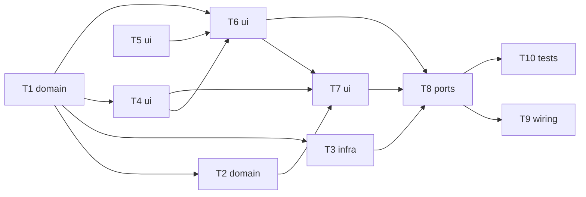

# Epic — dashboard-summary

> **Spec:** [spec.md](../spec.md) · **Design:** [sad.md](../sad.md) · **Screens:** [screens.md](../screens.md) · **Data model:** немає (міграцій і змін схеми не потрібно, SAD §5) · **API:** немає (одна HTML-сторінка `GET /`, SAD §4) · **ADRs:** [adr/](../adr/)

## Goal

Перший екран дашборду: одна публічна сторінка лише для читання з описом простою мовою, підсумками за всіма збереженими виїздами та списком виїздів, кожен з яких розгортається до повного звіту. Відсутнє значення — «немає даних», час — «отримано», номери без виїзду видно (spec §2 Goals). Дедлайн — презентація 2026-10-26.

## Scope

- **In:** `domain` (підсумки, хронологія), `db` (знімок читання), `web` (маршрут, шаблони, форматування, CSS), compose-alias і runbook публікації, інтеграційні тести.
- **Out:** графіки, автентифікація, показ відхилених, фільтри й автооновлення, відсоток заряду (spec §3); нова міграція; зміни `ingest`; застосування Caddyfile на сервері (робить Оператор після запису DNS).

## Task map

Паралельні гілки: T1 і T5 стартують разом; після T1 незалежні T2, T3, T4; T9 і T10 — паралельно після T8.

## Tasks

See [tracker.md](./tracker.md) for status. Machine contract: [tasks.json](../tasks.json).

| # | Task | Layer | Blocked by | DoD (short) |
|---|---|---|---|---|
| T1 | [Додати в domain типи виїзду, підсумки з Total(sum, missing) і класифікацію причини завершення](./t1-domain-summary.md) | domain | — | юніт-тести підсумків на фікстурах seq 26/27, порожньому наборі й «без пробігу» проходять без Docker |
| T2 | [Додати в domain хронологію виїздів із позначками номерів без виїзду](./t2-domain-timeline.md) | domain | T1 | юніт-тест хронології: порядок seq ↓, позначки пропусків на своїх місцях, `received_at` порядок не змінює |
| T3 | [Додати читання одного знімка лише для читання (db/reading.py) і налаштування таймаутів web](./t3-infra-read-snapshot.md) | infra | T1 | інтеграційний тест на реальному Postgres: один READ ONLY-знімок виїздів без raw і номерів без виїзду; запис у знімку відхиляється |
| T4 | [Додати web/formatting.py: «отримано» за Києвом, одиниці, підписи причин, назва ровера, текст звіту](./t4-ui-formatting.md) | ui | T1 | юніт-тести форматування: нуль ≠ None, одиниці з кому, Europe/Kyiv з переходом 2026-10-25, підписи причин |
| T5 | [Створити базовий макет, токени CSS, макроси «немає даних»/картка/повідомлення та блок «Опис»](./t5-ui-base-layout.md) | ui | — | юніт-тест рендеру: опис з 3 визначеннями, «немає даних» відрізняється від 0, у шаблонах і CSS немає зовнішніх адрес чи скриптів |
| T6 | [Побудувати сторінку dashboard.html: опис, вісім карток підсумків, стани empty і error](./t6-ui-summary-block.md) | ui | T1, T4, T5 | рендер-тест підсумків: вісім карток у порядку AC-01, нуль проти «немає даних», підпис «без даних у N з M», стани empty/error |
| T7 | [Побудувати список виїздів: розгортуваний рядок (details), позначка пропуску, блок повного звіту](./t7-ui-sessions-list.md) | ui | T2, T4, T6 | рендер-тест списку: 
 на виїзд з усіма полями AC-03, нуль проти «немає даних», позначки пропусків, XSS екрановано |
| T8 | [Додати маршрут GET / з читанням знімка, 503 при недоступному сховищі, заголовками безпеки і /static](./t8-ports-dashboard-route.md) | ports | T3, T6, T7 | юніт-тести маршруту: 200 для ok/empty, 503 без технічних подробиць, 405 на запис, заголовки безпеки |
| T9 | [Підготувати публікацію: alias rover-web у compose, фрагмент Caddyfile, runbook і скрипт перевірки](./t9-wiring-publish-ops.md) | wiring | T8 | compose без опублікованих портів з alias rover-web, runbook з Caddy/DNS/CONNECTION LIMIT/security review і скрипт перевірки |
| T10 | [Додати інтеграційні тести сторінки на реальному Postgres: свіжість, дубль, запис, затримка, зовнішні запити](./t10-tests-dashboard-e2e.md) | tests | T8 | інтеграційні тести на реальному Postgres: AC-17 свіжість, AC-18 дубль, AC-14 запис, p95 ≤ 1 с для 1000 виїздів, немає зовнішніх запитів |

## Risks / Hard rules

- **`NULL` ≠ 0 і «отримано»** (конституція №4, №5): жодне «немає даних» не стає числом; слів «час виїзду/сесії» немає. Правило живе в `domain` (T1) і в макросі `no_data` (T5).
- **Лише читання** (конституція №10, №11, ADR-0001): транзакція `READ ONLY` (T3), жодного маршруту з побічним ефектом (T8).
- **Без скриптів і зовнішніх вузлів** (ADR-0002, spec §6): CSP `default-src 'self'`, `
` замість JS (T5, T7, T8).
- **Без нових міграцій** — застосовані міграції не змінюються (конституція №16).
- **Затримка при ≤ 1000 виїздів** — сторінка несе всі звіти (SAD §11); замір у T10, при перевищенні — повернутися до ADR-0002.
- **Ручна перевірка на телефоні 360 px** — браузерного тест-інструмента в залежностях немає; перевіряє власник перед `/sdd:ship` (T10).
- **DNS `rover.romis.cloud`** — публікація заблокована до запису власника (T9, spec §8).
- **Числа з spec §6** (≤ 1 с, 360 px) — припущення, що власник підтверджує до `/sdd:plan-tests`; таймаути БД (T3) — вибір розбиття задач за SAD §4.
