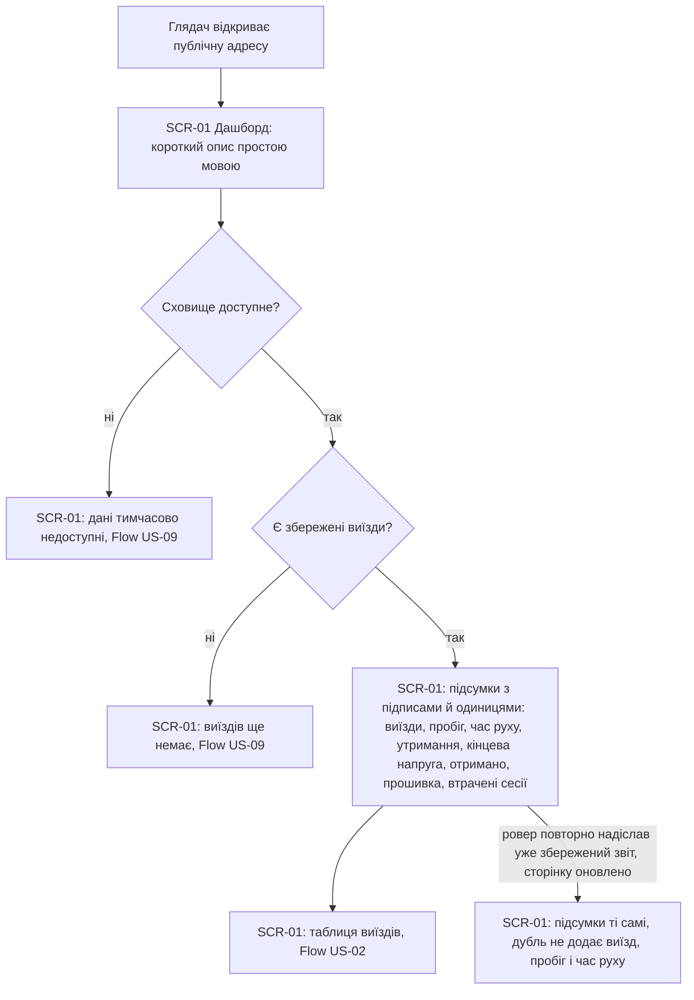
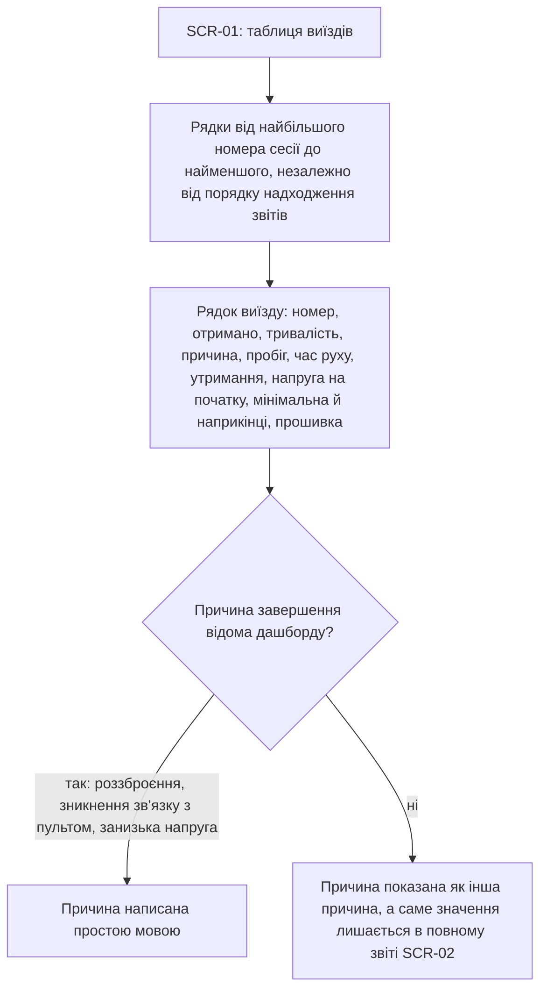
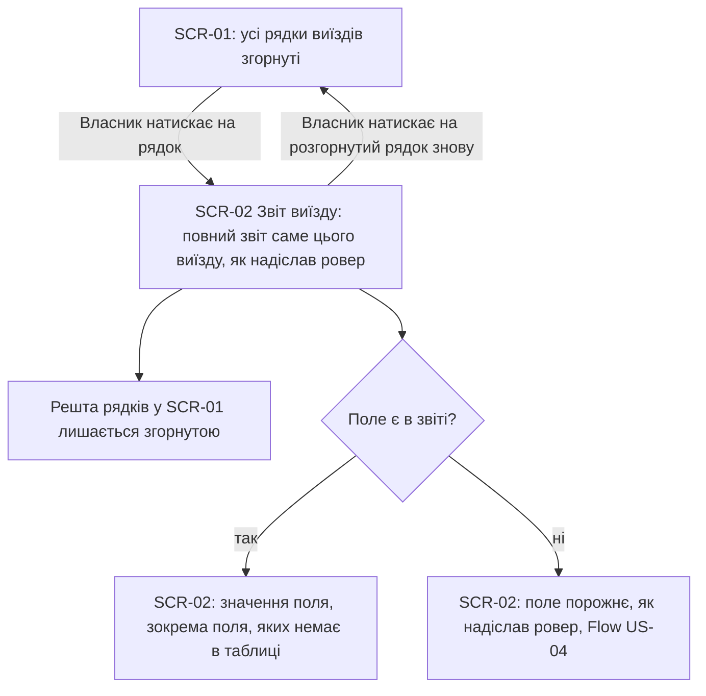
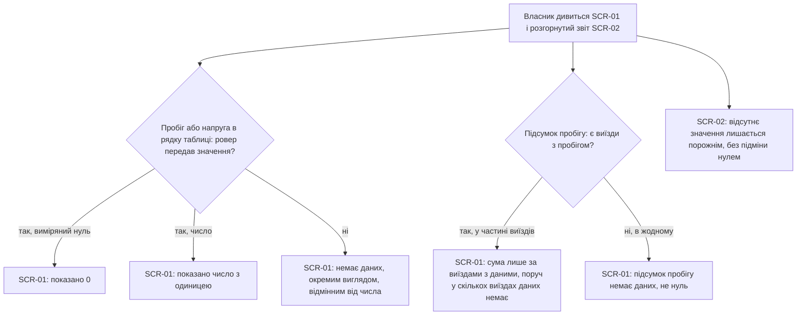
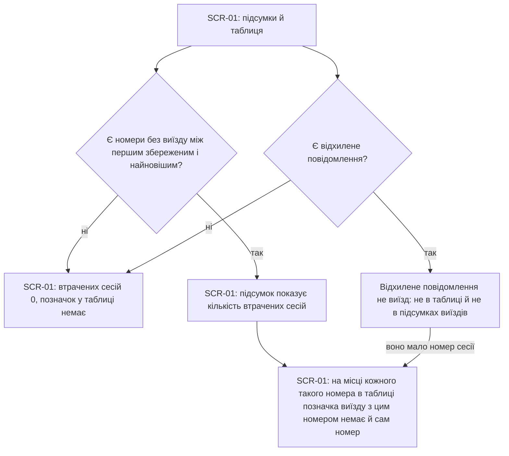
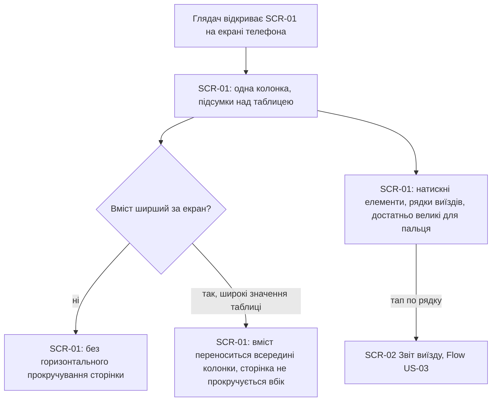
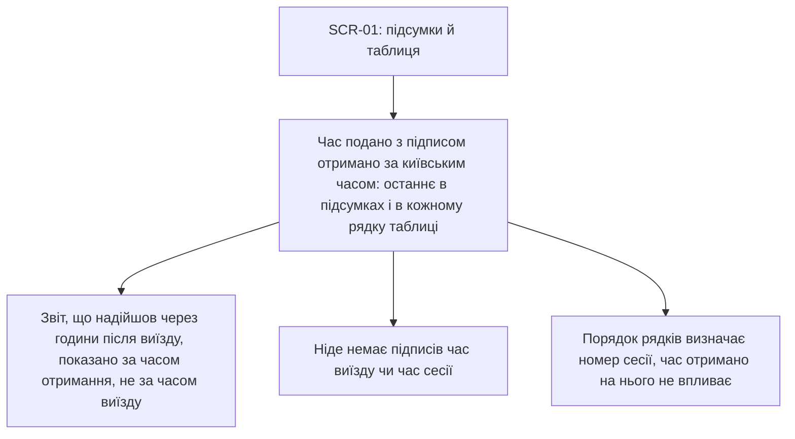
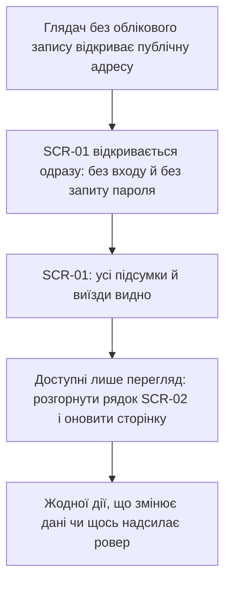
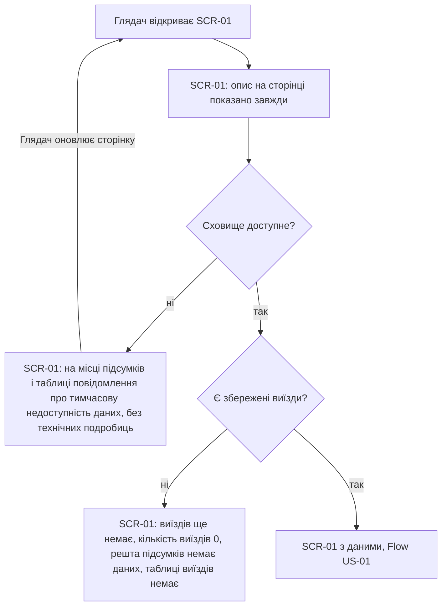
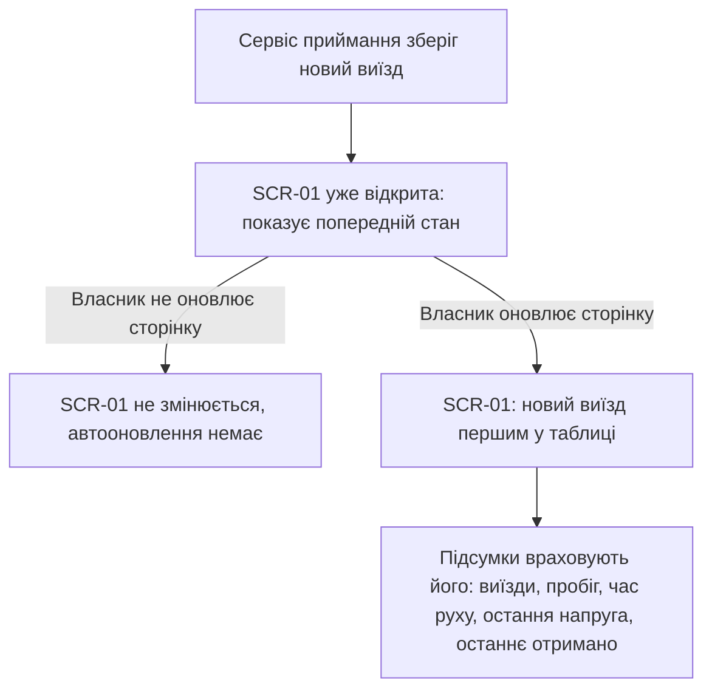

# UX flows — dashboard-summary

> Користувацькі флоу для кожної UI-історії §4, створені `ux-flows` (після `clarify`, перед `design`).
> Читають: `design` (докази для вибору поверхні й UI-архітектури), `sequences` (UI-флоу вирівнюються
> за id SCR), `screens` (деталізує кожен рядок інвентаря) і `plan-tests` (e2e-шляхи через UI).
> **Завжди markdown + mermaid `flowchart`**, незалежно від інструмента дизайну: це рівень потоку, не візуальний дизайн.

## Platform decisions

- **Posture:** mobile-first — за `docs/design-system.md` §Platform posture (глядачі презентації відкривають сторінку з телефона, AC-10); десктоп — розширення того самого макета, не окремий флоу.
- **Навігація:** одна публічна сторінка, переходів між сторінками немає. Єдина взаємодія — розгортання рядка виїзду на місці (без модального вікна й без окремої сторінки) та ручне оновлення сторінки.
- **Ролі:** Глядач і Власник ровера бачать одну й ту саму сторінку, облікових записів немає (конституція №12); відмінність лише в тому, що саме кожен робить на ній.
- **Оновлення даних:** лише ручне (оновлення сторінки), автооновлення й фільтрів немає (spec §3).
- **Допущення про розгортання (не з spec, винесено в screens):** повторне натискання на розгорнутий рядок його згортає; розгортання одного рядка не згортає інші автоматично.
- **Для `design` (не рішення тут):** розгортання сирого звіту (SCR-02) означає, що або звіти всіх виїздів віддаються разом зі сторінкою, або кожен підвантажується за натисканням; вибір між цим і вибір поверхні належать `design` і `target_surfaces`.

## Screen inventory

Станів екрана (порожньо, дані недоступні) в інвентарі немає: це стани SCR-01, їх деталізує `screens`.

| ID | Screen | Purpose | Entry | Exit |
|---|---|---|---|---|
| SCR-01 | Дашборд: опис, підсумки, таблиця виїздів | Показати загальну картину за всіма збереженими виїздами та перелік самих виїздів; стани: з даними, порожньо, дані недоступні | Відкриття публічної адреси; оновлення сторінки | Розгортання рядка виїзду (SCR-02); оновлення сторінки (знову SCR-01) |
| SCR-02 | Звіт виїзду (розгорнутий рядок) | Показати повний звіт одного виїзду так, як його надіслав ровер, зокрема поля, яких немає в таблиці | Натискання на згорнутий рядок виїзду в SCR-01 | Повторне натискання на рядок (назад до SCR-01) |

## Flows

### Flow: US-01 — Підсумки з першого погляду

Глядач відкриває публічну адресу й одразу бачить SCR-01: угорі короткий опис простою мовою (що це ровер, що таке виїзд, що означає утримання перед перешкодою). Далі сторінка перевіряє сховище: якщо воно недоступне або виїздів ще немає, показується відповідний стан (розписаний у флоу US-09). Якщо виїзди є, під описом стоять підсумки: кількість виїздів, сумарний пробіг, сумарний час руху, кількість утримань, кінцева напруга останнього виїзду, час «отримано» останнього звіту, версія прошивки останнього виїзду та кількість втрачених сесій, кожне з підписом і одиницею; нижче йде таблиця виїздів. Якщо ровер повторно надішле вже збережений звіт, то після оновлення сторінки підсумки не змінюються: дубль не збільшує ні кількість виїздів, ні пробіг, ні час руху.

### Flow: US-02 — Перелік виїздів

Власник дивиться таблицю в SCR-01: рядки йдуть від найбільшого номера сесії до найменшого, навіть якщо звіти надходили в іншому порядку. Кожен рядок містить номер, час «отримано», тривалість, причину завершення, пробіг, час руху, кількість утримань, напругу на початку, мінімальну й наприкінці та версію прошивки. Якщо причина завершення — роззброєння, зникнення зв'язку з пультом або занизька напруга, вона написана зрозумілою мовою. Якщо дашборд причини не знає, у рядку стоїть «інша причина», а справжнє значення можна побачити в розгорнутому звіті.

### Flow: US-03 — Повний звіт виїзду

Власник натискає на рядок виїзду в SCR-01, і рядок розгортається на місці в SCR-02: повний звіт саме цього виїзду так, як його надіслав ровер, з усіма полями, зокрема тими, яких немає в таблиці. Решта рядків лишається згорнутою. Поле, якого ровер не передав, у розгорнутому звіті порожнє (правило відсутніх значень — у флоу US-04). Повторне натискання на розгорнутий рядок повертає його до згорнутого вигляду.

### Flow: US-04 — Відсутнє значення не нуль

Таблиця розрізняє три випадки. Якщо ровер виміряв нуль, показано 0. Якщо передав число, показано число з одиницею. Якщо значення не передано (пробіг чи напруга), показано «немає даних» у вигляді, що відрізняється від числа. У підсумках сума пробігу враховує лише виїзди з даними, поруч указано, у скількох виїздах даних немає; якщо даних немає в жодному, підсумок показано як «немає даних», а не нуль. У розгорнутому звіті SCR-02 відсутнє значення лишається порожнім, без підміни нулем. Час руху в контракті завжди заданий, тому для нього окремої гілки немає.

### Flow: US-05 — Втрачені сесії видно

Власник бачить кількість втрачених сесій у підсумках, а в таблиці на місці кожного номера, під яким виїзду немає, стоїть позначка «виїзду з цим номером немає» з цим номером. Якщо пропусків немає, втрачених сесій нуль (виміряне число) і позначок у таблиці немає. Відхилене повідомлення не вважається виїздом: воно не потрапляє ні в таблицю, ні в підсумки. Якщо воно мало номер сесії, дашборд не відрізняє його від втраченої, і цей номер позначається так само, як будь-який номер без виїзду.

### Flow: US-06 — Зручно на телефоні

Глядач відкриває сторінку на телефоні й бачить усе в одну колонку: підсумки над таблицею. Сторінка ніколи не прокручується вбік: якщо вміст ширший за екран, він переноситься всередині колонки (як саме — рішення `screens`). Рядки виїздів, які розгортаються, достатньо великі для натискання пальцем; тап по рядку відкриває звіт виїзду (флоу US-03).

### Flow: US-07 — Час — «отримано»

Весь час на SCR-01 (останнє «отримано» в підсумках і «отримано» в кожному рядку таблиці) подається з підписом «отримано» за київським часом. Якщо звіт надійшов через години після самого виїзду, він показаний за часом отримання, і ніде він не названий часом виїзду чи сесії. Порядок рядків залежить лише від номера сесії.

### Flow: US-08 — Публічна сторінка лише для читання

Глядач без облікового запису відкриває публічну адресу, і SCR-01 відкривається одразу, без входу й запиту пароля. Він бачить усі підсумки й виїзди; єдині дії — розгорнути рядок (SCR-02) і оновити сторінку. Жодної дії, яка змінює збережені дані чи щось надсилає ровер, на сторінці немає. Решта US-08 (HTTPS, відсутність зовнішніх вузлів, права доступу до сховища, незалежність приймання від дашборду) — не UI, див. AC coverage.

### Flow: US-09 — Сторінка не ламається без даних

Опис на сторінці показується завжди. Якщо сховище тимчасово недоступне, на місці підсумків і таблиці стоїть повідомлення простою мовою, що дані тимчасово недоступні, без технічних подробиць про збій; решта сторінки цілою. Якщо сховище працює, але виїздів ще немає, сторінка каже, що виїздів ще немає: кількість виїздів показана як 0 (виміряне число), решта підсумків — «немає даних», таблиці немає. У будь-якому з двох станів оновлення сторінки знову запускає ту саму перевірку.

### Flow: US-10 — Свіжі виїзди

Після того як сервіс приймання зберіг новий виїзд, уже відкрита сторінка сама не змінюється, бо автооновлення немає. Коли Власник оновлює сторінку, новий виїзд стоїть першим у таблиці, а підсумки (кількість виїздів, пробіг, час руху, остання напруга, останній час «отримано») враховують його.

## AC coverage

| AC | Shown by | Notes |
|---|---|---|
| AC-01 | Flow US-01 → вузол E | Підсумки з підписами й одиницями |
| AC-02 | Flow US-01 → вузол B | Опис над підсумками |
| AC-03 | Flow US-02 → вузли B, C | Порядок за номером сесії й склад рядка |
| AC-04 | Flow US-02 → гілка D (так / ні) | Відома причина простою мовою, невідома як «інша причина» |
| AC-05 | Flow US-03 → вузли B, C | SCR-02, решта рядків згорнута |
| AC-06 | Flow US-04 → гілка B; вузол I | Нуль / число / немає даних у таблиці; порожнє поле в SCR-02 |
| AC-07 | Flow US-04 → гілка F (так / ні) | Сума лише за виїздами з даними, або «немає даних» |
| AC-08 | Flow US-05 → гілка B (так); вузли D, E | Підсумок і позначки в таблиці |
| AC-09 | Flow US-07 → вузли B, C, D, E | Підпис «отримано», київський час, порядок не залежить |
| AC-10 | Flow US-06 → вузли B, C, F | Одна колонка, без прокручування вбік, розмір цілі дотику |
| AC-11 | Flow US-09 → гілка E (ні) | Нуль виїздів як виміряне число, решта «немає даних» |
| AC-12 | Flow US-09 → гілка C (ні) | Повідомлення замість підсумків і таблиці, опис лишається |
| AC-13 | Flow US-08 → вузли B, C, D, E | Немає входу й жодної дії запису; ровер нічого не отримує — не UI |
| AC-14 | N/A: не видно в UI | Відмова сховища на запис від дашборду — права ролі БД; перевіряється тестом прав, не флоу |
| AC-15 | N/A: не видно в UI, крім входу | HTTPS, відсутність зовнішніх вузлів, незалежність від приймання — розгортання; UI-частина (сторінка відкривається за адресою) є початком кожного флоу |
| AC-16 | Flow US-05 → гілка F (так); вузол G | Відхилене не виїзд, номер позначається як номер без виїзду |
| AC-17 | Flow US-10 → вузли D, E | Після оновлення сторінки |
| AC-18 | Flow US-01 → вузол G | Дубль не змінює підсумки |

## Assumptions ledger (easy depth)

Рівень Easy: флоу записано без поштучного підтвердження, власник може ветувати будь-який зі списку.

- US-01: опис завжди зверху, далі підсумки й таблиця; дубль звіту видно лише як відсутність змін після оновлення.
- US-02: порядок і склад рядка взяті з AC-03 дослівно; невідома причина завершення показується як «інша причина».
- US-03: розгортання на місці (не модальне вікно, не окрема сторінка); повторне натискання згортає рядок; розгортання одного не згортає інші автоматично (ні spec, ні контракт цього не вимагають).
- US-04: три стани значення (нуль, число, немає даних) і дві гілки підсумку пробігу; для часу руху гілки немає, бо в контракті він завжди заданий.
- US-05: позначка «виїзду з цим номером немає» однакова для втраченого й відхиленого номера (відкрите питання в spec §8, дедлайн до `/sdd:data-model`).
- US-06: «вміст переноситься всередині колонки» — лише вимога без макета; конкретика належить `screens` (spec §8, останнє питання).
- US-07: окремої гілки для «відставання» звіту немає, бо це правило підпису, а не розгалуження.
- US-08: лише UI-частина (немає входу й дій запису); AC-14 і AC-15 винесені як не-UI.
- US-09: недоступне сховище й порожня база — стани SCR-01, а не окремі екрани; оновлення сторінки повторює перевірку.
- US-10: автооновлення немає (spec §3), оновлення лише вручну.
