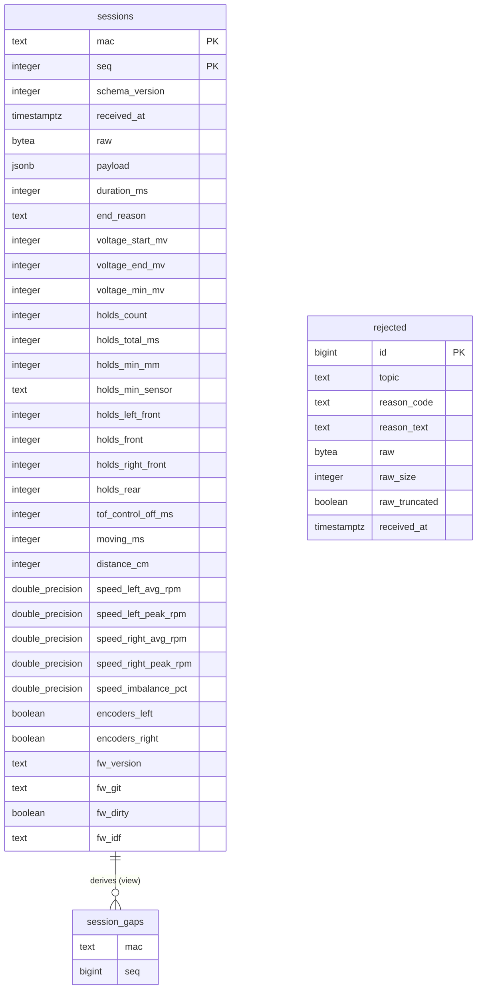

# Data model — ingest

Схема БД `rover` (Postgres 16): дві таблиці й одне представлення. Конвенції взято з архітектури, а не вигадано: природний ключ `(mac, seq)` (конституція №6), `NULL` ≠ 0 (№4), лише `received_at` без часу сесії (№5), сирий вміст поруч із розібраними колонками (№8, feature ADR-0002), права `ingest` лише `INSERT`, `viewer` лише `SELECT` (№10, ADR-0005), облік втрат — SQL-представлення (ADR-0004).

## Aggregate roots

| Aggregate | Root | Що володіє |
|---|---|---|
| Сесія ровера | `sessions` | Один збережений валідний звіт; ідентичність — `(mac, seq)` |
| Відхилене повідомлення | `rejected` | Одне доставлене повідомлення, що не стало сесією; зв'язку із `sessions` немає навмисно (відхилений звіт не займає номер сесії, AC-05b) |
| Облік втрат | `session_gaps` (view) | Похідні дані від `sessions`; нічого не зберігає (ADR-0004) |

FK між таблицями немає: `rejected` не посилається на `sessions`, представлення читає лише `sessions`.

## ER diagram

## Entities

### `sessions`

Джерело колонок — таблиці полів у `docs/contracts/events.md`. Ім'я колонки = шлях поля контракту, крапка → підкреслення (`holds.min_mm` → `holds_min_mm`, `fw.dirty` → `fw_dirty`).

| Column | Type | Constraints | Notes |
|---|---|---|---|
| `mac` | text | PK (частина 1), NOT NULL | Ідентифікатор ровера, 12 hex нижнім регістром (контракт, «Доставка»); збігається з топіком, перевіряє `domain` (`id_mismatch`) |
| `seq` | integer | PK (частина 2), NOT NULL | Номер сесії (контракт, «Ідентифікатор для дедублікації») |
| `schema_version` | integer | NOT NULL | Завжди 1 для збереженого: інші версії відхиляються (`unsupported_schema`, AC-07). Колонка потрібна, щоб майбутня міграція версій не вгадувала її з `payload` |
| `received_at` | timestamptz | NOT NULL | Час сервісу UTC на вході в callback (SAD §8 «Time»). Єдина часова мітка (AC-11). `DEFAULT` немає: значення ставить `domain`, до розбору |
| `raw` | bytea | NOT NULL | Точні байти повідомлення, ≤ 1024 (feature ADR-0002, AC-12) |
| `payload` | jsonb | NOT NULL | Розбір `raw` для запитів; невідомі поля лишаються тут і в `raw` (конституція №8) |
| `duration_ms` | integer | NULL | Контракт «Сесія». Відсутнє поле = `NULL`, не відхилення (AC-05) |
| `end_reason` | text | NULL | `disarm` / `failsafe_link_lost` / `failsafe_voltage` за контрактом; значення не обмежуються `CHECK`, бо нове значення не має ламати запис (US-07) |
| `voltage_start_mv` | integer | NULL | Контракт: `int \| null` |
| `voltage_end_mv` | integer | NULL | |
| `voltage_min_mv` | integer | NULL | |
| `holds_count` | integer | NULL | `holds.count`; 0 = виміряно «утримань не було», `NULL` = немає даних (AC-10) |
| `holds_total_ms` | integer | NULL | `holds.total_ms` |
| `holds_min_mm` | integer | NULL | `holds.min_mm`; `NULL`, якщо утримань не було |
| `holds_min_sensor` | text | NULL | `holds.min_sensor` |
| `holds_left_front` | integer | NULL | `holds.by_sensor.left_front` |
| `holds_front` | integer | NULL | `holds.by_sensor.front` |
| `holds_right_front` | integer | NULL | `holds.by_sensor.right_front` |
| `holds_rear` | integer | NULL | `holds.by_sensor.rear`. Лічильники зберігаються як надіслано, без перерахунку (AC-02) |
| `tof_control_off_ms` | integer | NULL | |
| `moving_ms` | integer | NULL | |
| `distance_cm` | integer | NULL | Контракт: `null`, якщо не було енкодера; 0 — виміряний нуль (AC-10) |
| `speed_left_avg_rpm` | double precision | NULL | Контракт: `number \| null` (дробові, приклад 88.4) |
| `speed_left_peak_rpm` | double precision | NULL | |
| `speed_right_avg_rpm` | double precision | NULL | |
| `speed_right_peak_rpm` | double precision | NULL | |
| `speed_imbalance_pct` | double precision | NULL | |
| `encoders_left` | boolean | NULL | `encoders.left` |
| `encoders_right` | boolean | NULL | `encoders.right` |
| `fw_version` | text | NULL | `fw.version` |
| `fw_git` | text | NULL | `fw.git` |
| `fw_dirty` | boolean | NULL | Контракт: поле відсутнє, якщо збірка не повідомила → `NULL` |
| `fw_idf` | text | NULL | `fw.idf` |

**Aggregate root:** root.
**Access patterns:** дедублікація `INSERT … ON CONFLICT DO NOTHING` за `(mac, seq)` → PK; облік втрат групує й шукає за `(mac, seq)` → той самий PK.
**Constraints:** єдине обмеження унікальності — PK `(mac, seq)`. **Інваріант безпеки (feature ADR-0005):** другого `UNIQUE` не додавати — `ON CONFLICT DO NOTHING` без цілі інакше мовчки трактуватиме його конфлікти як дублі; перевіряє тест на єдине обмеження.
**Без:** `CHECK` на діапазони (spec AC-05: перевірок діапазонів немає), `updated_at` (рядок ніколи не змінюється, AC-03), `DEFAULT` (значення ставить `domain`), soft delete (видалення заборонено ролям, AC-15/16).

**Рішення, яке потребує підтвердження власника (`<!-- TBD -->`):** `mac` — `text` без `CHECK` на формат. Формат перевіряє `domain` до запису; `CHECK` у БД не додано, бо в репозиторії немає прецеденту (greenfield), а роль `ingest` не повинна падати на записі.

### `rejected`

| Column | Type | Constraints | Notes |
|---|---|---|---|
| `id` | bigint | PK, `GENERATED ALWAYS AS IDENTITY` | Сурогат: у відхилених немає природного ключа, кожна доставка дає окремий запис (AC-05, SAD §8 «ID strategy») |
| `topic` | text | NOT NULL | Топік доставки `rover/<mac>/session`; потрібен, бо `mac` з невалідного вмісту недовіряний (AC-06) |
| `reason_code` | text | NOT NULL | Один із: `too_large`, `not_json`, `unknown_event`, `unsupported_schema`, `missing_id`, `id_mismatch`, `bad_type` (SAD §8 «Reason codes»). Без `CHECK`: перелік може рости, а запис відхиленого не має падати |
| `reason_text` | text | NOT NULL | Причина простою мовою (AC-05) |
| `raw` | bytea | NOT NULL | Перші ≤ 1024 байти повідомлення, дослівно (ADR-0002). `bytea`, бо сміття може бути не UTF-8 і містити нуль-байти |
| `raw_size` | integer | NOT NULL | Початковий розмір повідомлення в байтах |
| `raw_truncated` | boolean | NOT NULL | Позначка обрізання; до ліміту 1024 не входить (AC-07). Явного `DEFAULT` немає: значення ставить `domain` |
| `received_at` | timestamptz | NOT NULL | Час «отримано» (AC-05) |

**Aggregate root:** root.
**Access patterns:** лише вставка в цій фічі; читання (дашборд, крок 6 роудмапу) — окрема фіча.
**Constraints:** PK `id`. `rejected` не має ключа дедублікації (feature ADR-0005, «Neutral»).
**Права:** `ingest` — `INSERT`; для ідентичності окремого права на послідовність не потрібно (перевіряє інтеграційний тест ролей).

### `session_gaps` (view)

| Column | Type | Notes |
|---|---|---|
| `mac` | text | Ровер |
| `seq` | bigint | Номер втраченої сесії |

Логіка (ADR-0004): для кожного `mac` діапазон `generate_series(min(seq), max(seq))` мінус збережені `seq`. Початок обліку — найменший збережений `seq` (AC-08); запізніла сесія сама зникає з пропусків (AC-09); менший номер сам зсуває початок. Нічого не зберігається, роль `ingest` про представлення не знає.
**Права:** `viewer` — `SELECT`. Представлення виконується з правами власника (`owner`), тож `viewer` не потребує окремого читання через нього, але отримує `SELECT` і на таблиці (AC-08: Власник ровера читає SQL).

## Indexes

Окремих індексів поза PK немає. Кожен кандидат із ключових запитів відхилено або покрито PK.

| Index | Columns | Query it serves |
|---|---|---|
| `sessions_pkey` (PK) | `(mac, seq)` | `INSERT … ON CONFLICT DO NOTHING` (sequence 1); `min/max(seq) GROUP BY mac` і антипошук у `session_gaps` (ADR-0004, AC-08/09/17) |
| `rejected_pkey` (PK) | `(id)` | Ідентичність запису; окремого читального запиту в цій фічі немає |

**Відхилені кандидати (немає конкретного запиту, що виграє):**
- `sessions(received_at)` — запит «час останнього `received_at`» (SAD §7, моніторинг) виконується вручну на малій таблиці (кілька рядків на день, `docs/idea-brief.md` §4); індекс подорожчав би запис. Повернутися, якщо дашборд (крок 3) додасть сортування за «отримано» на великому обсязі.
- `rejected(received_at)` — читального запиту в цій фічі немає.
- Індексів на FK немає: FK відсутні.

## Test fixtures

Фікстури не в `migrations/`. Форма — як у репозиторії: файли `tests/fixtures/` і pytest-фікстури.

- `tests/fixtures/session_seq26.json`, `session_seq27.json` — реальні звіти (конституція №15); перевіряють AC-02 і відповідність `payload` = розбір `raw`.
- Синтетичні набори для `session_gaps` (28, 29, 31; зсув початку; запізніла 30; два `mac` з однаковим `seq`) будуються в тесті SQL-представлення; значення `mac` — довільні 12 hex (`aabbccddeeff`), без реальних даних.
- Ролі для інтеграційних тестів: фікстура створює `ingest` і `viewer` до застосування міграцій (GRANT потребує існування ролей, SAD §7 крок 1).
