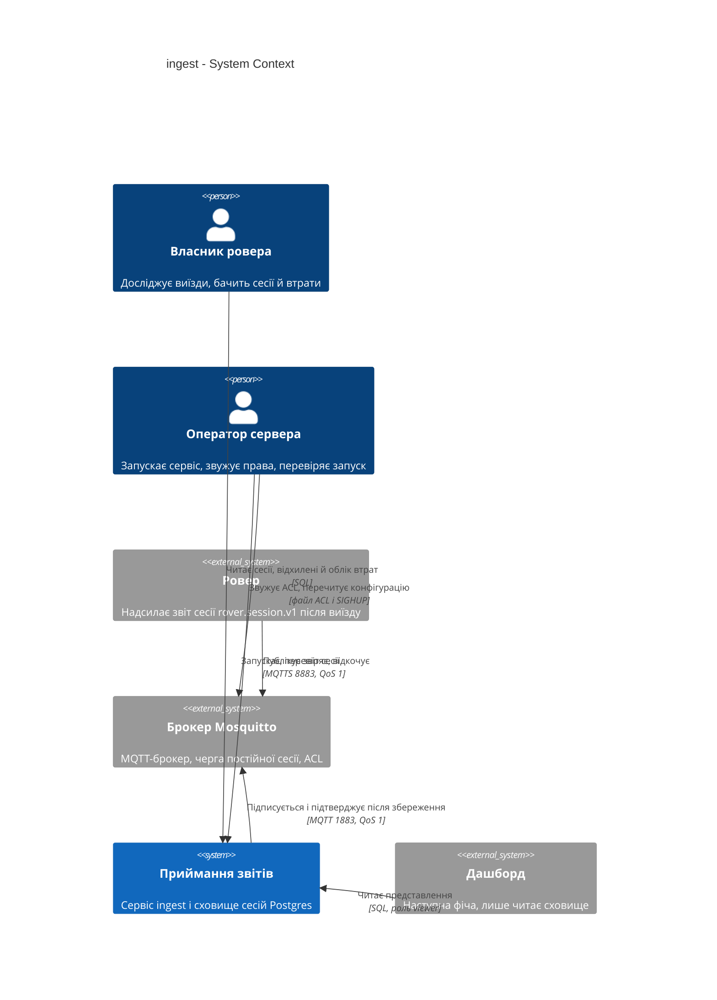
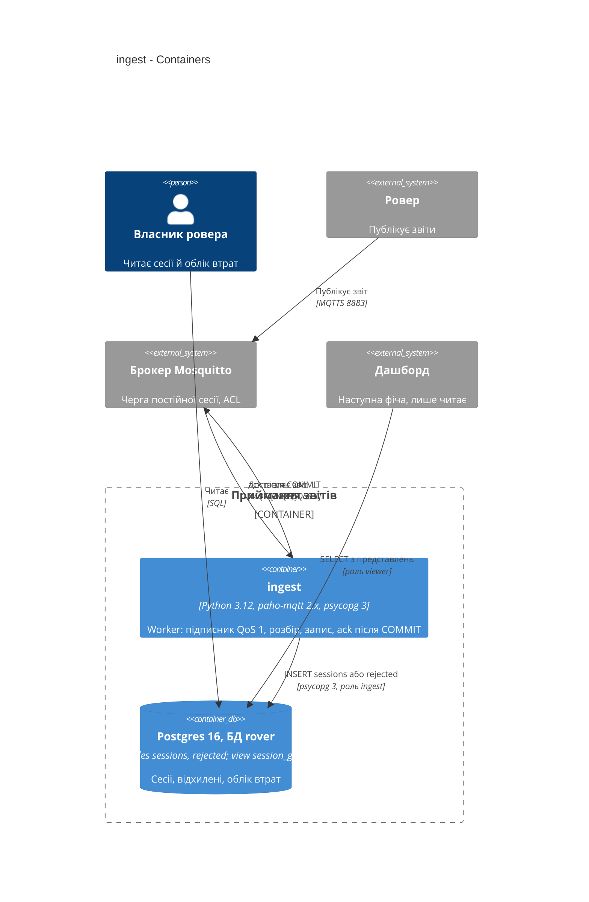
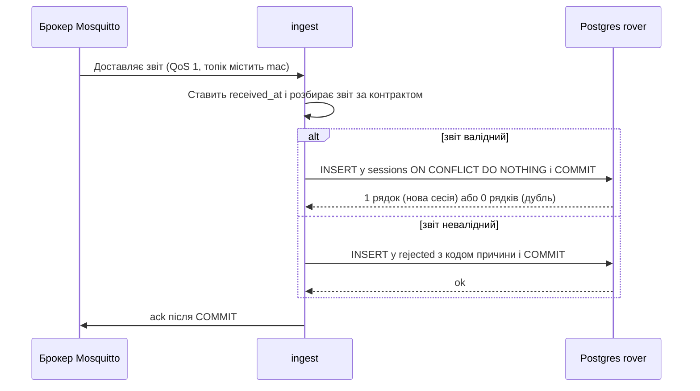
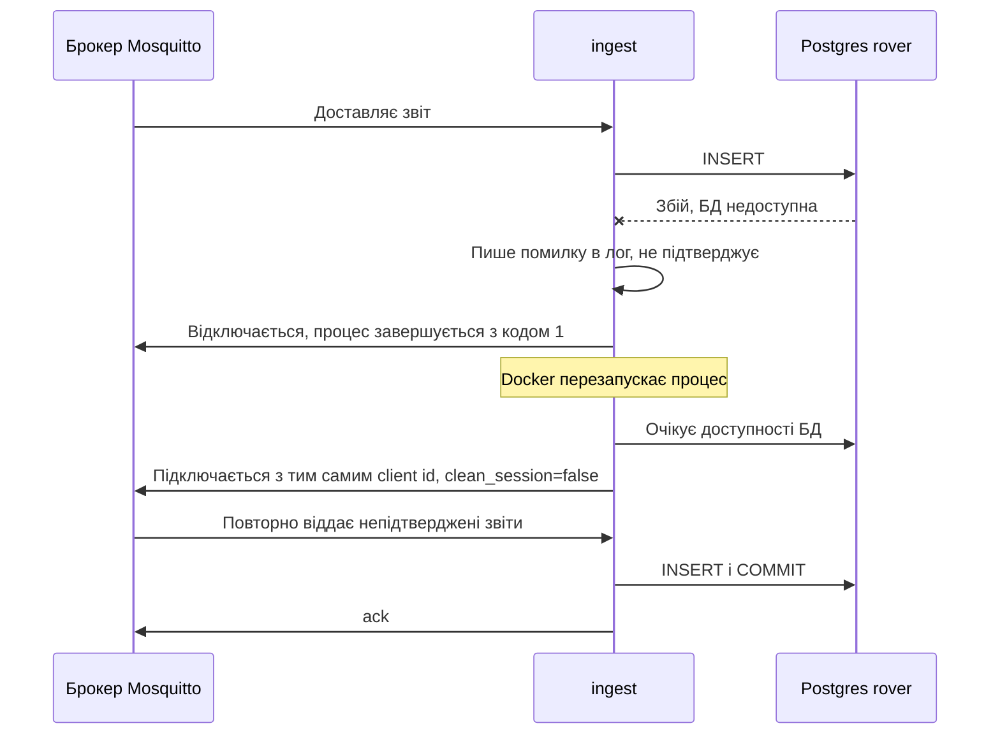
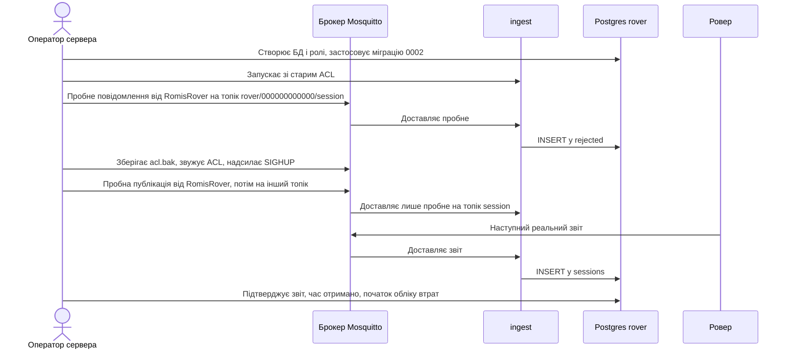

# Software Architecture Document — ingest

<!-- 12 Arc42 sections. Empty section → <!-- N/A: <one-line reason> -->. -->
<!-- C4 Context (L1) lives inline in §3. C4 Container (L2) lives inline in §5. -->
<!-- Numbers in §10 come VERBATIM from spec.md §6 NFR — no inventing, no rounding. -->

> Фундаментальні ADR проєкту (`docs/adr/0001…0003`) тут називаються «фундаментальний ADR-NNNN». ADR цієї фічі лежать у `adr/` і нумеруються окремо (0001…0005).

## 1. Introduction and goals

**Intent.** Кожен звіт сесії, що дійшов до сервісу після запуску, ніколи не зникає мовчки: він зберігається як сесія, як відхилений із причиною або визнається повтором. Фоновий сервіс-підписник `ingest` приймає звіти ровера з брокера MQTT, перевіряє їх за контрактом `rover.session.v1`, пише в Postgres і лише після COMMIT підтверджує отримання брокеру. Разом із запуском права ровера, сервісу приймання й дашборду звужуються до найменших потрібних (spec §2).

**Top-3 quality goals (1-liners; full scenarios in §10):**

1. **Збереженість** — жоден звіт не підтверджено брокеру без збереження (як сесія чи як відхилений).
2. **Самовідновлення і наздоганяння** — після збою БД чи брокера сервіс сам продовжує, а накопичена черга обробляється швидко й без дублів.
3. **Найменші права й безпечне звуження** — витік одного пароля не дозволяє підробити звіт чи змінити збережене, а звуження ACL не губить виїзди ровера.

**Stakeholders.**

| Role | Interest | Sign-off owner? |
|---|---|---|
| Ровер | Надсилає звіти, нічого не отримує; його буфер тримає лише 2 недоставлені | No |
| Власник ровера | Бачить історію виїздів, дублі не завищують пробіг, пропуски `seq` видно | No |
| Оператор сервера | Запускає сервіс, звужує права, перевіряє запуск, відкочує при невдачі | No |
| Tech Lead (12romis) | Затвердження SAD | Yes |

<!-- Decision overrides (¶4) — populated by the critic resolution loop, empty otherwise. -->

## 2. Constraints

**Technical.**
- Python 3.12 (образ `python:3.12-slim`), `paho-mqtt` 2.x з `manual_ack`, `psycopg` 3 з сирим SQL без ORM (`docs/architecture-map.md`, фундаментальний ADR-0001, ADR-0003).
- Postgres 16 у наявному контейнері `postgres` (образ `pgvector/pgvector:pg16`), окрема БД `rover`; ролі `owner` (міграції), `ingest` (лише INSERT), `viewer` (лише SELECT) — конституція №10.
- Брокер Mosquitto 2: `persistence true`, `max_queued_messages 1000`, `message_size_limit 262144`, внутрішній listener `mosquitto:1883` (`/opt/mosquitto/config/mosquitto.conf`).
- Звіт ≤ 1024 байти UTF-8 JSON, QoS 1, топік `rover/<mac>/session` (`docs/contracts/events.md`, канонічний, не редагується).
- Шари: `domain` ← `db` ← `ingest`, `ingest` не залежить від `web` (фундаментальний ADR-0002); один образ, два сервіси (фундаментальний ADR-0001).
- Міграції `yoyo-migrations`: пари `NNNN_<назва>.sql` + `.rollback.sql`; застосована `0001_init` порожня, фіча додає `0002`. Застосовані міграції не змінюються (конституція №16).

**Organisational.**
- Один розробник. Ціль власника: сервіс запущено в проді і наступний реальний звіт збережено до кінця 2026-10-23 (spec §7); презентація 2026-10-26. Реалістичність цілі — відкрите питання spec §8 (SAD §11).
- Рішення власника, ухвалені під час design (2026-10-23): вікно очікування перед відкатом прав після виїзду без збереженого звіту — 30 хв (AC-20); суперечливий повтор ігнорується як звичайний дубль (AC-03b). Закривають два питання spec §8, термін яких був «до design».

**Conventions.**
- `docs/constitution.md` (зокрема №3 «жодного числа без джерела», №4 `null` ≠ 0, №5 час «отримано», №6, №7, №10) і `docs/architecture-map.md` §Conventions.
- Природний ключ сесії `(mac, seq)`, без сурогатного ключа. Коментарі й документи українською, ідентифікатори й SQL англійською (конституція №13).
- Тести на розбір використовують фікстури `tests/fixtures/` (seq 26 і 27) — конституція №15.

**Regulatory / external.**
- Дані публічні, персональних даних немає (spec §6.1). Security review: Required — нова межа авторизації; перед першим push у публічний репозиторій потрібен пошук секретів у compose-файлах, тестах і логах.
- Паролі лише в `~/.config/claude-secrets/rover.env` / `.env` поза git; у репозиторії лише `.env.example` (конституція №9).

## 3. Context and scope

Ровер після кожного виїзду публікує один звіт у брокер; звіти ніде не накопичуються, а без збережених даних нічого показати на дашборді (кроки 3–6 роудмапу). Система приймання — це сервіс `ingest` разом зі сховищем сесій у Postgres: вона приймає звіти з брокера, зберігає їх і дає читачам (Власнику ровера, майбутньому дашборду) сесії, відхилені звіти та облік втрачених сесій.

<!-- brownfield: скелет після /sdd:scaffold (commit 8306542): пакет `src/rover_telemetry/` з порожніми `domain/`, `db/`, `ingest/` (точка входу відразу виходить із повідомленням), `config.py` з єдиним `DATABASE_URL`, `docker-compose.yml` зі службою `ingest` та спільним `env_file: .env`, `migrations/0001_init.sql` (порожня), фікстури seq 26 і 27. Логіки фічі немає. -->

**External systems (in / out):**

| Actor or system | Type | Interaction |
|---|---|---|
| Ровер | System (external) | Публікує звіт сесії в брокер (MQTTS 8883, QoS 1); не підписується, нічого не отримує |
| Брокер Mosquitto | System (external до цієї фічі, наша інфраструктура) | Зберігає непідтверджені звіти в черзі постійної сесії `ingest`, віддає їх, застосовує ACL |
| Власник ровера | Person | Читає сесії, відхилені й облік втрат у сховищі (SQL, далі дашборд) |
| Оператор сервера | Person | Запускає сервіс, виконує одноразове налаштування БД і ролей, звужує ACL, перевіряє запуск, відкочує |
| Дашборд (наступна фіча) | System (external до цієї фічі) | Лише читає представлення від ролі `viewer`; у цій фічі не реалізується |

**C4 Context (L1):**



## 4. Solution strategy

**Target surface: `worker`.** Фіча вводить один процес без запитів і відповідей: підписник на події з брокера. Дашборд (`web-frontend`) — окрема фіча, крок 3 роудмапу, тож UI-архітектурного рішення і `ux-flows`/`screens` тут немає. Кількість поверхонь одна, тож рішення не дає ADR; у frontmatter `target_surfaces: [worker]`.

**Top strategic choices (the seeds for ADRs):**

1. **Спершу збереження, потім підтвердження; при збої виходимо** — повідомлення обробляються по одному: розбір → INSERT → COMMIT → `ack`; помилка запису = вихід без `ack`, Docker перезапускає процес, брокер віддає непідтверджене знову. Це напряму дає «0 звітів, підтверджених без збереження» (QG-1) і відновлення без пам'яті процесу (QG-2) — feature ADR-0001.
2. **Оригінал плюс розібране** — для кожного повідомлення зберігаються точні байти (`raw bytea`), розібрані колонки (`NULL` ≠ 0) і `payload jsonb`; невідомі поля ігноруються при розборі, але лишаються в `raw`/`payload`; відхилене зберігається з причиною і вмістом, обрізаним по байтах до 1024 — feature ADR-0002.
3. **Дубль і відхилений — нормальні результати, а не помилки** — чиста функція `domain` повертає або сесію, або відхилення з кодом причини; сесія вставляється `ON CONFLICT DO NOTHING` без цілі конфлікту (бо роль `ingest` лише вставляє), дубль видно за `rowcount = 0` — feature ADR-0005.
4. **Права звужені і звужуються оборотно** — три облікові записи брокера й три ролі Postgres; ACL звужується після того, як `ingest` перевірено, з пробною публікацією до виїзду і відкатом — feature ADR-0003. Рядки підключення до БД роздаються на контейнер.
5. **Втрати рахуються, а не зберігаються** — втрачені сесії дає SQL-представлення від найменшого збереженого `seq`, тож облік сам сходиться за довільного порядку доставки — feature ADR-0004.

Тактичні рішення цього етапу (без ADR, бо відкат — години, а не дні): `received_at` — час сервісу в UTC на вході в callback, до розбору; розбір — власна чиста функція в `domain` без pydantic/jsonschema; логування — рядки `key=value` у stdout; БД і ролі створює одноразовий скрипт Оператора від суперкористувача Postgres (паролі не в git), а таблиці, представлення і GRANT — міграція `0002` від `owner`, `ingest` міграцій не запускає.

Окреме уточнення: початок обліку втрат визначається найменшим збереженим `seq` (spec AC-08), а не «першим за часом отримання»; для AC-19 це те саме значення, якщо перший прийнятий звіт найстаріший, і `plan-tests` має перевірити обидва порядки.

## 5. Building block view

Прості шари за фундаментальним ADR-0002: чистий `domain` (розбір і правила), `db` (сирий SQL через `psycopg` 3), `ingest` (клієнт MQTT і оркестрація). Фіча працює в наявних модулях скелета, нового модуля не створює; `web` не змінюється. Каталог `ops/` — не модуль, а область одноразових скриптів Оператора (потрібен суперкористувач Postgres і доступ до файлів брокера); його немає в `docs/architecture-map.md`, карту оновить наступний `survey`. Правило залежностей лишається: `domain` нічого не імпортує з проєкту, `db` залежить від `domain`, `ingest` від обох.

**Internal decomposition** (імена файлів — пропозиція для `tasks`):

```
src/rover_telemetry/
├── domain/
│   └── report.py        # parse_report(topic, payload, received_at) -> ParsedSession | Rejection; без I/O
├── db/
│   └── sessions.py      # insert_session, insert_rejected; з'єднання з таймаутами; лише INSERT
├── ingest/
│   └── __main__.py      # очікування БД, підключення до брокера, on_message -> parse -> db -> ack, вихід при збої
└── config.py            # INGEST_DATABASE_URL, MQTT_*, client id; без значень за замовчуванням для паролів
migrations/
├── 0002_sessions_rejected.sql           # sessions, rejected, представлення session_gaps, GRANT
└── 0002_sessions_rejected.rollback.sql
ops/                     # одноразові скрипти Оператора (не міграції): ролі й БД, ACL-шаблон, перевірки запуску
```

**C4 Container (L2):**



## 6. Runtime view

**Critical flow 1: приймання звіту (happy path, дубль, відхилений).**



**Critical flow 2: збій сховища і відновлення (зовнішня залежність).**



**Critical flow 3: запуск і звуження ACL.**



Решту потоків (кожне AC: усі гілки відхилення, зсув початку обліку, наздоганяння черги, відкат AC-20) покриває `sequences`.

## 7. Deployment view

`ingest` — другий сервіс у `docker-compose.yml` (той самий образ `rover-telemetry`, команда `python -m rover_telemetry.ingest`), мережа `infra`, порти на хост не публікуються (конституція №12), `restart: unless-stopped`. Одна репліка: другий екземпляр із тим самим client id витісняв би перший. Рядок підключення до БД роздається на контейнер (`INGEST_DATABASE_URL` лише в `ingest`, `WEB_DATABASE_URL` лише в `web`, через `environment:`), бо поточний `env_file: .env` дає обом сервісам увесь файл — це змінюється в задачах (compose, `.env.example`, `config.py`). Сховище — наявний Postgres у мережі `infra`. Брокер змінюється лише ACL і файлом паролів.

**Launch checklist (feature ADR-0003):**

1. Скрипт Оператора від суперкористувача Postgres створює БД `rover` і ролі `owner`, `ingest`, `viewer`; паролі беруться з `~/.config/claude-secrets/rover.env`.
2. `yoyo` від `owner` застосовує `0002` (таблиці, представлення, GRANT).
3. У файл паролів брокера додаються `rover-ingest` і `rover-viewer`; ACL розширюється лише читанням для них; `RomisRover` поки `readwrite rover/#`; SIGHUP.
4. Запуск `ingest`; при першому підключенні порівняти перший отриманий `seq` із 27 (spec §8: чи є вже черга).
5. Пробне повідомлення від `RomisRover` наскрізь до `rejected` (топік `rover/000000000000/session`).
6. `cp acl acl.bak`, звужений ACL (`RomisRover` лише `write rover/+/session`), SIGHUP; пробні публікації (дозволений і інший топік); `rover-ingest` не може публікувати.
7. Наступний реальний звіт: перевірити сесію, час «отримано», початок обліку втрат і розрив до 27 (AC-19).
8. Невдача (AC-20): після 30 хв з відомого завершення виїзду без збереженого звіту — `cp acl.bak acl` і SIGHUP.

**Monitoring:**
- Метрики: немає окремого сервера метрик; рядки логу `event=stored|duplicate|rejected|error` з `latency_ms` (різниця між `received_at` і COMMIT) читаються через `docker logs ingest`.
- Алерти: немає (Telegram-сповіщення — non-goal, рішення власника №12); сигнали — лічильник перезапусків `docker inspect` і час останнього `received_at` у `sessions` (SQL-запит).
- Tracing: не потрібен для одного процесу.

**Scaling thresholds:**
- Обсяг малий: ровер їздить щодня, виїздів небагато, ровер один (`docs/idea-brief.md` §4; рішення власника №10); масштабувати не потрібно.
- Порогів для кількох роверів немає — питання виникне, коли з'явиться другий ровер (спільний обліковий запис брокера тоді треба розділити, AC-13).

## 8. Crosscutting concepts

| Concept | Convention | Where defined |
|---|---|---|
| Logging | Один рядок `key=value` на подію в stdout: `event` (`stored`/`duplicate`/`rejected`/`error`), `mac`, `seq`, `reason_code`, `received_at`, `latency_ms`; без вмісту звіту й без паролів | тут |
| Authentication / AuthZ | Три облікові записи брокера (`RomisRover` лише `write rover/+/session`, `rover-ingest` лише `read`, `rover-viewer` лише `read`) і три ролі Postgres (`owner` — міграції, `ingest` — лише `INSERT` на `sessions`, `rejected`, `viewer` — лише `SELECT`); `ingest` не читає, не змінює, не видаляє | конституція №10, рішення власника №5, feature ADR-0003, ADR-0005 |
| Error handling | Невалідне повідомлення не падає процес: збережене в `rejected` з кодом причини і текстом, потім `ack`; збій сховища — вихід без `ack`; виняток `ReportError` у `domain` | конституція №7, feature ADR-0001, `docs/architecture-map.md` |
| Reason codes | Фіксований перелік, перший спрацьований у порядку: `too_large`, `not_json`, `unknown_event`, `unsupported_schema`, `missing_id`, `id_mismatch`, `bad_type`; відсутність інших полів і явні `null` — не причина; перевірок діапазонів немає; точні значення колонки уточнює `data-model` | spec AC-05…AC-07 |
| ID strategy | Природний ключ `(mac, seq)`; для `rejected` — сурогатний ідентифікатор запису | конституція №6, feature ADR-0005 |
| Time | `received_at timestamptz` = час сервісу UTC на вході в callback; ніякого «часу сесії»; у UI «отримано», пояс Europe/Kyiv | конституція №5, рішення власника №11 |
| NULL vs 0 | Відсутнє значення — `NULL` у БД, `None` у `domain`; виміряний нуль — нуль; агрегації `NULL` не підставляють нулем | конституція №4 |
| Schema evolution | Невідомі поля ігноруються при розборі, але лишаються в `raw` і `payload`; несумісна зміна — лише з новим `schema_version` (відхиляється як `unsupported_schema`) | конституція №8, feature ADR-0002 |
| Configuration / secrets | Змінні середовища; пароль і рядок підключення лише з `~/.config/claude-secrets/rover.env` / `.env`; назви в `.env.example` | конституція №9 |
| Internationalisation | N/A — один інтерфейс-мова (українська), у сервісі немає тексту для користувача, окрім причини відхилення простою мовою | — |
| Events / ack | QoS 1, фіксований client id, `clean_session=false`, `manual_ack`; `ack` лише після COMMIT, лише в тому самому з'єднанні | конституція №7, feature ADR-0001 |

## 9. Architecture decisions

| # | Title | Status | Section |
|---|---|---|---|
| 0001 | Підтверджувати звіт брокеру лише після COMMIT і виходити з процесу при збої сховища | Accepted | §4 |
| 0002 | Зберігати точні байти повідомлення поруч із розібраними колонками | Accepted | §4 |
| 0003 | Звужувати ACL брокера поетапно з пробною публікацією і відкатом | Accepted | §4 |
| 0004 | Рахувати втрачені сесії SQL-представленням від найменшого збереженого номера | Accepted | §4 |
| 0005 | Вставляти сесії через ON CONFLICT DO NOTHING без цілі конфлікту | Accepted | §4 |

ADR files live under `docs/features/ingest/adr/NNNN-<title>.md`. Решта рішень (стек, шари, схема на рівні «сира SQL + представлення», стиль міграцій) уже закріплена фундаментальними ADR-0001…0003 (`docs/adr/`) і конституцією, тож нових ADR не потребує.

## 10. Quality requirements

Числа NFR у spec §6 позначені «пропозиція, див. §8» (підтвердження власника — before `/sdd:plan-tests`); тут вони цитуються дослівно.

**QG-1. Збереженість**
- **When:** сервіс отримує звіт, а сховище недоступне посеред запису.
- **Then:** 0 звітів, підтверджених брокеру без збереження як сесії чи відхиленого; після відновлення сховища звіт збережено рівно один раз (AC-18).
- **How verify:** інтеграційний тест зі збоєм сховища посеред запису; порівняння підтверджень і записів.

**QG-2. Самовідновлення і наздоганяння**
- **When:** сервіс вимкнено, ровер надсилає звіти, брокер зберігає їх у черзі, сервіс запускається; або після збою сервіс перепідключається.
- **Then:** до 1000 накопичених повідомлень оброблено ≤ 60 с після старту; після збою сервіс сам перепідключається і продовжує ≤ 60 с; облік втрат показує лише справжні пропуски (AC-17).
- **How verify:** тест із 1000 синтетичних звітів; приймальний тест із перезапуском сервісу.

**QG-3. Найменші права і безпечне звуження**
- **When:** облікові дані ровера, сервісу приймання чи дашборду використовуються поза своєю роллю; або ACL звужено.
- **Then:** брокер і сховище відмовляють (AC-13…AC-16); звіт ровера після звуження зберігається (AC-19), а при невдачі права відкочуються (AC-20).
- **How verify:** тести ролей Postgres (INSERT-only, SELECT-only); ручна перевірка запуску за чек-листом §7; на синтетичному брокері — пробна публікація дозволена й заборонена.

**QS-4. Затримка збереження**
- **When:** штатний режим.
- **Then:** ≤ 5 с (p95) від отримання сервісом до збереження.
- **How verify:** різниця між часом «отримано» і часом збереження в журналі сервісу (`latency_ms`).

**QS-5. Точність розбору і розмір відхиленого**
- **When:** розбираються звіти з `tests/fixtures/`; надходить повідомлення понад межу.
- **Then:** 100 % значень фікстур з номерами 26 і 27 збігаються з контрактом; відхилений вміст ≤ 1024 байти на запис, понад це вміст обрізається по байтах із окремою позначкою.
- **How verify:** модульні тести на `tests/fixtures/`; тест із повідомленням понад межу.

**QS-6. Видимі втрати**
- **When:** у нумерації ровера з'являється пропуск.
- **Then:** кожна втрачена сесія від першої отриманої видна в обліку втрат у межах 1 хв після появи пропуску.
- **How verify:** запит до `session_gaps` на синтетичному наборі з навмисним пропуском.

## 11. Risks and technical debt

| Risk / debt | Severity | Mitigation | Owner |
|---|---|---|---|
| Помилка в ACL: брокер на заборонений запис відповідає `PUBACK RC:0` і мовчки відкидає, ровер стирає звіт; помилка не видна без активної перевірки | High | Feature ADR-0003: пробна публікація до виїзду, відкат `acl.bak`; залишковий ризик — звіт у вікні між SIGHUP і виявленням не відновлюється | 12romis |
| Запуск до кінця 2026-10-23 може не відбутися (spec §8) | Medium | Пріоритет ingest і ACL; якщо ні, перенести на ранок 2026-10-24; рішення before `/sdd:tasks` | 12romis |
| Невідомо, чи вже є постійна сесія на брокері і скільки виїздів після 27 лежить у черзі (spec §8) | Low | Порівняти перший отриманий `seq` із 27 при першому підключенні; розрив після 27 — довідка, не втрата | Оператор сервера |
| Числа NFR (5 с, 60 с, 1 хв) — пропозиція без джерела в контракті (spec §8) | Low | Лишаються як у spec §6 до підтвердження власника before `/sdd:plan-tests` | 12romis |
| Пауза між перезапусками Docker наростає за політикою перезапуску (верхня межа — за документацією Docker) і може з'їсти запас NFR «≤ 60 с» | Medium | Очікування БД на старті в процесі (feature ADR-0001); перевірка приймальним тестом з перезапуском | 12romis |
| Спільний `env_file: .env` дає обом сервісам усі паролі, що суперечить найменшим правам (конституція №10) | Medium | Рядки підключення на контейнер через `environment:` у compose, окремі змінні `INGEST_DATABASE_URL` / `WEB_DATABASE_URL`; завдання на правку compose, `.env.example`, `config.py` | 12romis |
| Підроблений звіт із майбутнім номером створить хибний довгий «пропуск» (feature ADR-0004) | Medium | Записувати може лише обліковий запис `RomisRover`; права звужено в момент запуску (spec §6.1) | 12romis |
| Другий екземпляр `ingest` (або локальний запуск проти прод-брокера) із тим самим client id витісне перший з'єднання і зіб'є чергу | Medium | Одна репліка; окремий client id для тестів; ніколи не запускати локальний `ingest` проти прод-брокера | 12romis |
| `ON CONFLICT DO NOTHING` без цілі перетворить конфлікт будь-якого майбутнього UNIQUE на «дубль» (feature ADR-0005) | Low | Тест, що `sessions` має рівно одне обмеження унікальності | 12romis |
| Усі публікації ровера на інші топіки після звуження мовчки відкидаються | Low | Рішення власника №5; контракт знає лише `session`; перевірка при запуску | 12romis |
| Пробний запис у `rejected` (топік `rover/000000000000/session`) спотворює KPI «відхилені від справжнього ровера» | Low | KPI виключає записи із синтетичним MAC за топіком | 12romis |
| Безпека: перед першим push у публічний репозиторій потрібен пошук секретів у compose-файлах, тестах і логах (spec §6.1) | Medium | Перевірка `/sdd:review` і `sync`-скрипт; секрети лише в `rover.env` | 12romis |

**Accepted debt (acceptable in v1, plan to fix later):**
- Суперечливий повтор не розрізняється й не записується (рішення власника, spec §3): сирий вміст першої сесії зберігається, тож розрізнення можна додати пізніше.
- Відхилені повідомлення не перероблюються автоматично (spec §3).
- Немає алертів: про простій сервісу дізнаються за відсутністю звітів і лічильником перезапусків.
- Немає резервних копій до кроку 7 роудмапу (рішення власника №6): втрата БД до того безповоротна.
- Облік втрат починається з найменшого збереженого `seq`; сесії до першої отриманої (наприклад, 1–27) не рахуються (spec AC-08; рішення власника №7 формулює як «від першого отриманого»).

## 12. Glossary

| Term | Meaning |
|---|---|
| Звіт сесії | Одне повідомлення, яким ровер описує одну сесію; може прийти через години чи дні після виїзду |
| Сесія (виїзд) | Період від озброєння ровера до роззброєння чи аварійної зупинки; NOT постійна сесія підписника на брокері |
| Відхилений звіт | Повідомлення, що не стало сесією (невалідне, непідтримана версія, ідентифікатори не збігаються), збережене з причиною і вмістом |
| Дубль | Повторна доставка звіту з тим самим ровером і номером сесії; нічого не додає, у відхилені не потрапляє |
| Втрачена сесія | Номер сесії ровера, що не дійшов; рахується від найменшого збереженого номера (spec AC-08; CONTEXT.md каже «від першого отриманого», різниця лише при довільному порядку доставки); NOT відхилений звіт |
| Отримано (`received_at`) | Час, коли сервіс прийняв звіт; верхня межа часу сесії; NOT час сесії |
| Ровер | Пристрій, що надсилає звіти й ідентифікується MAC плати (`mac`) |
| Власник ровера / Оператор сервера | Людина-дослідник даних / та ж людина в ролі того, хто підтримує сервер, брокер і сховище |
| Постійна сесія підписника | Технічне з'єднання з брокером (`clean_session=false`, фіксований client id), у чергу якого брокер складає непідтверджені звіти |
| `ack` | Підтвердження отримання брокеру; надсилається лише після COMMIT |
| ACL | Файл брокера з правами облікових записів на топіки; перечитується SIGHUP |
| Код причини (`reason_code`) | Один із фіксованого переліку (§8), чому повідомлення відхилено |
| `session_gaps` | SQL-представлення втрачених сесій від найменшого збереженого `seq` (feature ADR-0004) |

<!-- Терміни `ack`, ACL, `reason_code`, `session_gaps` і «постійна сесія підписника» (технічне значення) не мають запису в CONTEXT.md, а «Втрачена сесія» там сказана «від першого отриманого» проти «найменшого збереженого» у spec AC-08 — кандидати для `/sdd:glossary`. -->
