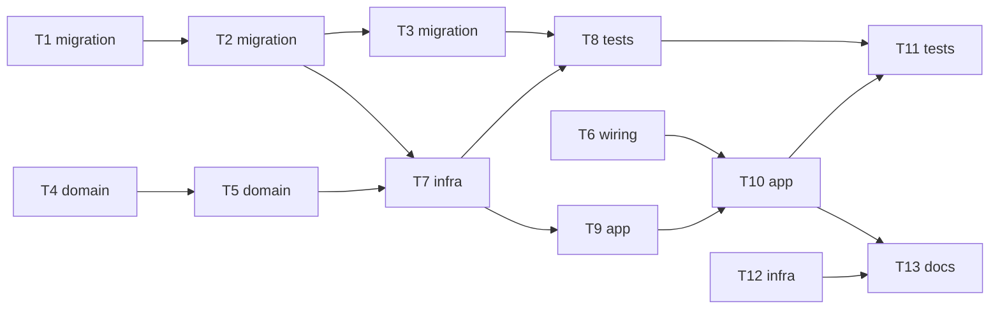

# Epic — ingest

> **Spec:** [spec.md](../spec.md) · **Design:** [sad.md](../sad.md) · **Data model:** [data-model.md](../data-model.md) · **API:** — (поверхні API немає, `target_surfaces: [worker]`) · **ADRs:** [adr/](../adr/)

## Goal

Фоновий сервіс-підписник `ingest` приймає кожен звіт сесії ровера з брокера, зберігає його як сесію або як відхилений із причиною й підтверджує брокеру лише після COMMIT. Права ровера, сервісу й дашборду звужуються до найменших потрібних, а запуск у проді підтверджується наступним реальним звітом (spec §2).

## Scope

- **In:** три міграції (`sessions`, `rejected`, `session_gaps`), чистий розбір звіту в `domain`, шар запису в `db`, процес-підписник в `ingest`, розділення налаштувань і паролів у compose, скрипти Оператора в `ops/` (БД і ролі, ACL брокера, перевірка запуску, відкат).
- **Out:** дашборд і агрегації (кроки 3–6 роудмапу), резервні копії (крок 7), час сесії та нові поля контракту, завантаження сесій 26 і 27 у базу, Telegram-сповіщення, розрізнення суперечливого повтору й автоматична повторна обробка відхилених (spec §3).

## Task map

Паралельні гілки першої хвилі: T1 (міграції), T4 (domain), T6 (налаштування), T12 (скрипт БД).

Хвилі: 1: T1, T4, T6, T12; 2: T2, T5; 3: T3, T7; 4: T8, T9; 5: T10; 6: T11, T13.

## Tasks

See [tracker.md](./tracker.md) for status. Machine contract: [tasks.json](../tasks.json).

| # | Task | Layer | Blocked by | DoD (short) |
|---|---|---|---|---|
| T1 | Промотувати міграцію таблиці sessions у live migrations/ як 0002 | migration | — | інтеграційні тести з чеклиста проходять (`pytest -m integration`) |
| T2 | Промотувати міграцію таблиці rejected як 0003 | migration | T1 | тести з чеклиста проходять |
| T3 | Промотувати міграцію представлення session_gaps як 0004 | migration | T2 | `0004_create_session_gaps` застосовується й відкочується чисто |
| T4 | Розібрати валідний звіт у ParsedSession (domain.parse_report, щасливий шлях) | domain | — | `pytest tests/unit/test_report_valid.py` проходить для фікстур seq 26 і 27 |
| T5 | Відхиляти невалідні повідомлення з кодом причини (domain.parse_report, гілки Rejection) | domain | T4 | `pytest tests/unit/test_report_rejected.py` проходить: усі 7 причин, порядок, обрізання |
| T6 | Розділити налаштування й паролі: INGEST_DATABASE_URL, MQTT_*, compose environment | wiring | — | `pytest tests/unit/test_config.py` проходить |
| T7 | Записувати сесії й відхилені: db.sessions.insert_session / insert_rejected | infra | T2, T5 | `pytest tests/integration/test_db_inserts.py` проходить на ефемерному Postgres 16 |
| T8 | Перевірити ролі Postgres і облік втрат session_gaps | tests | T3, T7 | обидва файли тестів проходять (`pytest -m integration`) |
| T9 | Обробити одне повідомлення: розбір → запис → COMMIT → результат (ingest.handler) | app | T7 | `pytest tests/integration/test_handler.py` проходить |
| T10 | Запустити підписника: очікування БД, MQTT QoS 1 з manual ack, вихід при збої | app | T6, T9 | `pytest tests/unit/test_runner.py` проходить |
| T11 | Наскрізні тести ingest: збій сховища, наздоганяння 1000 звітів, перезапуск | tests | T8, T10 | `pytest -m integration tests/integration/test_ingest_e2e.py` проходить |
| T12 | Скрипт Оператора: створити БД rover і ролі owner, ingest, viewer | infra | — | `shellcheck ops/bootstrap_db.sh` без зауважень (або `bash -n`, якщо shellcheck відсутній) |
| T13 | Скрипти Оператора: ACL брокера, пробна публікація, перевірка запуску, відкат | docs | T10, T12 | `shellcheck ops/*.sh` без зауважень (або `bash -n`) |

## Risks / Hard rules

- Звіт підтверджується брокеру лише після COMMIT; при збої сховища процес виходить без `ack` (конституція №7, ADR-0001).
- `null` ≠ 0; відсутнє значення — `NULL`/`None`, ніде не підставляється нулем (конституція №4).
- Лише `received_at`, жодного часу сесії (конституція №5).
- `sessions` має рівно одне обмеження унікальності, інакше `ON CONFLICT DO NOTHING` без цілі приховає чужий конфлікт (ADR-0005).
- Права: `ingest` лише `INSERT`, `viewer` лише `SELECT` (конституція №10); паролі лише поза git (№9); `ops/` не містить значень секретів.
- Застосовані міграції не змінюються; зміна схеми — нова міграція (№16). Staged-міграції промотуються в `migrations/` як `0002`–`0004` задачами T1–T3.
- Помилка в ACL мовчки відкидає звіти ровера (`PUBACK RC:0`): звуження прав — лише з пробною публікацією й відкатом (ADR-0003, T13).
- Рішення, ухвалені цим розбиттям і варті уваги власника: початкові `DB_WAIT_INTERVAL_S` = 2 с і `DB_CONNECT_TIMEOUT_S` = 5 с (ADR-0001 лишив їх `tasks`, T6); відсутнє або не-`int` `schema_version` → `unsupported_schema`, неправильний тип `mac`/`seq` → `bad_type` (spec мовчить, T5).
- Відкриті питання spec §8: числа NFR/KPI (5 с, 60 с, 1 хв) — до `plan-tests`; реалістичність запуску до кінця 2026-10-23 — за замовчуванням ціль лишається (T13 і T12 — критичний шлях запуску).
