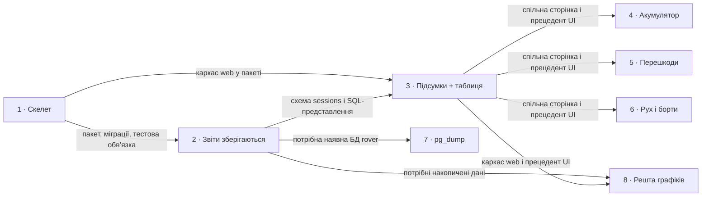

# Roadmap — romis-rover-telemetry

> **A decomposition, not a promise.** The overall idea broken into incremental steps: what each
> step is, where it comes from, how big it is — or that nobody has looked at it yet — and in which
> order, and parallel lanes, we walk them. **No dates** (except shipped history), **no scores** —
> order is the prioritization. The *solution* for any step lives in its `docs/features/<slug>/`
> spec, not here.

## Destination

Звіти кожного виїзду ровера зберігаються в Postgres, а публічний дашборд на `rover.romis.cloud`, зручний на телефоні, показує їх так, що власнику й глядачам презентації зрозуміло, як працював ровер.

## Steps

| # | Step | Source | Size | Status |
|---|---|---|:---:|---|
| 1 | Скелет проєкту: пакет, pytest із фікстурами, міграції, ruff/mypy, Docker, CI | `docs/architecture-map.md` Module inventory, `docs/features/_scaffold/tasks.json` | M | shipped |
| 2 | Звіти зберігаються: розбір за контрактом, БД `rover` (`sessions`, `rejected`, ролі), ingest, звужений ACL брокера і запуск у проді з перевіркою реального звіту | `docs/idea-brief.md` §7 Recommendation | L | idea |
| 3 | Публічний дашборд: дизайн-канон, каркас `web`, домен через Caddy, блок «Підсумки + таблиця виїздів» | `docs/idea-brief.md` §5 Out of scope | M | idea |
| 4 | Блок «Акумулятор»: старт, мінімум, кінець, просадка по виїздах | `docs/idea-brief.md` §5 Out of scope | M | idea |
| 5 | Блок «Перешкоди»: схема ровера з 4 датчиками (`holds.by_sensor`) і розподіл `holds.min_mm` проти порога | `docs/idea-brief.md` §5 Out of scope | L | idea |
| 6 | Блок «Рух і борти»: лівий проти правого, швидкості, сесії без енкодера | `docs/idea-brief.md` §5 Out of scope | M | idea |
| 7 | Щоденний `pg_dump` | `docs/idea-brief.md` §5 Out of scope | S | idea |
| 8 | Решта графіків: активність у часі, цикли заряду, склад часу виїзду, якість даних → see [Not yet specified](#not-yet-specified) | `docs/idea-brief.md` §5 Out of scope | fog | idea |

## Not yet specified

| Area | What we'd have to learn | Blocks | How it gets sharpened |
|---|---|:---:|---|
| Решта графіків (активність, цикли заряду, склад часу, якість даних) | Точне правило нового циклу заряду (8400 мВ — повний заряд), як подати склад часу з вимкненим захистом, яку форму має шкала `seq` з пропусками | 8 | Розвідка на реальних даних після кількох тижнів роботи ingest, потім розмова з власником |

## Out of scope

- Зворотний канал до ровера — конституція №11.
- Сповіщення в Telegram через n8n — не в першій версії, рішення власника №8/12.
- Автентифікація дашборду — наразі публічний, рішення власника №4, конституція №12.
- Нові поля події та час сесії — лише через зміну контракту ровера, конституція №2 і №5.
- Відсоток заряду — лише вольти, рішення власника №8.
- Завантаження сесій seq 26 і 27 у базу — пропуск 28…N виглядав би як збій ровера; вони лише фікстури.

## Open decisions

| # | Question | Type | Owner | Blocks |
|---|---|:---:|:---:|:---:|
| D1 | Як подати вибірку з кількох виїздів, щоб не ввести глядачів в оману (`by_sensor` рахує датчики, злипання за «отримано», `null` проти 0) | grilling | human | 3 |
| D2 | Точне правило нового циклу заряду | grilling | human | 8 |
| D3 | Чи існує вже постійна сесія підписника на брокері (`docker logs mosquitto` під час першого підключення ingest; порівняти перший `seq` із 27) | research | agent | 2 |
| D4 | Створити DNS-запис `rover.romis.cloud` до розгортання | task | human | 3 |

## Decisions so far

- Один Python-код для ingest і дашборду → [`ADR-0001`](adr/0001-use-one-python-codebase-for-ingest-and-dashboard.md)
- Шарувата структура пакета з чистим `domain` → [`ADR-0002`](adr/0002-use-layered-package-with-pure-domain.md)
- Сирі SQL-міграції і SQL-представлення → [`ADR-0003`](adr/0003-use-raw-sql-migrations-and-sql-views.md)
- Дашборд публічний без автентифікації → [`constitution.md`](constitution.md) №12
- Якщо до понеділка презентації не встигнути всі блоки, першим відкидається «Рух і борти»; порядок блоків — Акумулятор, Перешкоди, Рух і борти → [`idea-brief.md`](idea-brief.md) §6 Risks
- ACL звужується разом із запуском ingest, окремого кроку немає → [`idea-brief.md`](idea-brief.md) §7 Recommendation

## Dependency graph

## Execution path

Зони з `docs/architecture-map.md`; шляхів у репозиторії ще немає (greenfield), тож усі позначені `(new)`.

| Wave | Steps | Zone per step (why parallel-safe) | Unlocks |
|:---:|---|---|---|
| 1 | 1 | `pyproject.toml`, `Dockerfile`, `.github/` (new) | 2, 3 |
| 2 | 2 | `src/rover_telemetry/domain/`, `db/`, `ingest/`, `migrations/` (new); поза репо — `/opt/mosquitto/config/acl` | 3, 7 |
| 3 | 3 | `src/rover_telemetry/web/` (каркас, `base.html`, `app.css`), `/opt/n8n/Caddyfile` (new) | 4, 5, 6, 8 |
| 4 | 4 ∥ 5 ∥ 6 | 4: `web/blocks/battery` · 5: `web/blocks/obstacles` · 6: `web/blocks/motion` (new, окремі маршрут і шаблон кожного; спільна сторінка дашборду — місце потенційного конфлікту) | 8 |
| 5 | 7 | `ops/backup` (new), після презентації за рішенням власника №6 | — |

Крок 8 — fog, у хвилі не входить; спершу розвідка.

## Shipped

| Step | Shipped | Link |
|---|---|---|
| 1 · Скелет проєкту | 2026-10-23 | коміт `8306542` |
